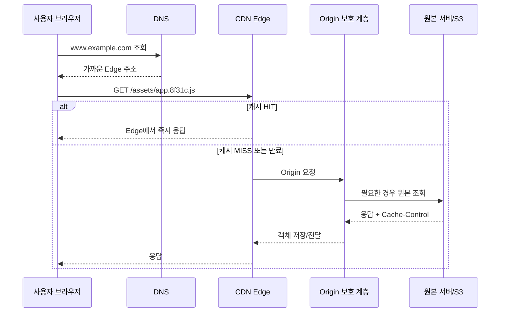
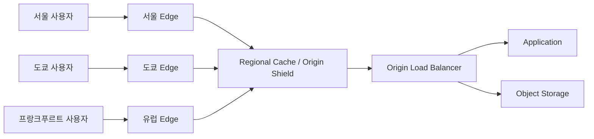
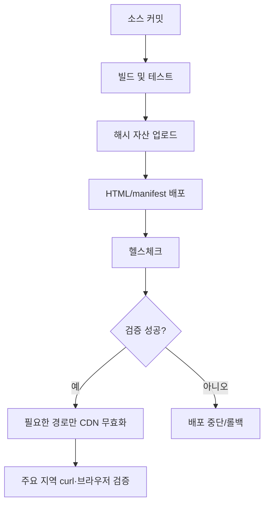

CDN(Content Delivery Network)은 정적 파일을 여러 지역에 복사해두는 서비스라고만 이해하기 쉽다. 실제 운영에서 CDN은 이미지와 JavaScript를 빠르게 내려주는 저장소를 넘어, **사용자의 요청을 어디에서 종료할지 결정하고, 어떤 응답을 누구에게 재사용할지 결정하는 HTTP 계층**이다.

이 계층을 대충 붙이면 이미지가 빨라지는 대신 오래된 JavaScript가 배포되거나, 로그인한 사용자의 응답이 다른 사용자에게 전달되거나, 캐시가 전부 MISS가 되어 원본 서버가 더 느려질 수 있다. 반대로 캐시 키와 TTL, 원본 보호, 무효화 정책을 함께 설계하면 네트워크 비용·서버 부하·사용자 지연 시간을 동시에 줄일 수 있다.

이 글에서는 CDN을 인프라, 애플리케이션 개발, 백엔드, 프론트엔드 관점에서 나눠 보되 마지막에는 하나의 운영 모델로 합친다. 특정 CDN 제품의 콘솔 클릭 순서보다 어느 사업자를 사용해도 적용할 수 있는 원칙을 중심으로 설명한다.

## CDN이 실제 요청에서 하는 일

브라우저가 `https://www.example.com/assets/app.8f31c.js`를 요청한다고 하자. DNS가 CDN의 엣지 주소를 반환하면 요청은 가장 가까운 엣지에서 먼저 처리된다. 엣지에 같은 캐시 키의 신선한 객체가 있으면 원본 서버에 가지 않고 바로 응답한다. 없거나 만료되었으면 CDN이 원본으로 요청을 보내고, 응답을 저장한 뒤 사용자에게 돌려준다.



여기서 중요한 단어는 `가까운`보다 **같은 캐시 키**, **신선도**, **원본 요청**이다. 사용자가 서울에 있더라도 캐시 키가 요청마다 달라져 전부 MISS가 되면 CDN의 지리적 이점은 거의 사라진다. 반대로 캐시 키를 지나치게 단순하게 만들면 개인별 응답이 섞일 수 있다.

## 캐시를 네 단계로 나누어 생각한다

CDN만 캐시를 갖는다고 생각하면 TTL을 잘못 조정하기 쉽다. 실제 요청에는 여러 캐시가 존재한다.

1. **브라우저 캐시**: 사용자의 디스크나 메모리에 저장된다.
2. **통신사·사내 프록시 캐시**: 공유 캐시로 동작할 수 있다.
3. **CDN Edge 캐시**: 지역별 엣지에 객체를 저장한다.
4. **백엔드 캐시**: Redis, 애플리케이션 메모리, DB 버퍼 등이 원본 내부에서 동작한다.

HTTP `Cache-Control`은 이 계층들이 응답을 재사용해도 되는지 알려주는 공통 계약이다. 예를 들어 다음 응답은 공개된 버전 파일을 오랫동안 공유 캐시할 수 있다는 뜻이다.

```http
HTTP/2 200 OK
Content-Type: application/javascript
Cache-Control: public, max-age=31536000, immutable
ETag: "app-8f31c"
```

반대로 로그인 사용자 정보는 공유 캐시에 저장되면 안 된다.

```http
HTTP/2 200 OK
Content-Type: application/json
Cache-Control: private, no-store
Vary: Accept-Encoding
```

`public`, `private`, `no-store`, `max-age`, `s-maxage`, `stale-while-revalidate`의 의미를 구분해야 한다. 브라우저와 공유 캐시에 같은 정책을 적용하고 싶지 않다면 `max-age`와 `s-maxage`를 분리한다.

```http
Cache-Control: public, max-age=60, s-maxage=600, stale-while-revalidate=30
```

이 응답은 브라우저에서는 60초, 공유 캐시에서는 600초 동안 신선하다. 공유 캐시가 오래된 객체를 30초 동안 제공하면서 백그라운드로 재검증하도록 허용하는 구조도 표현할 수 있다. HTTP 캐시의 신선도와 검증 규칙은 [RFC 9111](https://www.rfc-editor.org/rfc/rfc9111.html)이 기준이다.

## 인프라 관점: CDN은 원본 앞의 경계다

### 1. Origin을 공개하지 않는다

CDN을 앞에 두고도 원본 EC2나 Kubernetes LoadBalancer를 인터넷에 그대로 공개하면 공격자가 CDN을 우회할 수 있다. 원본은 다음 중 하나로 CDN에서 온 요청만 허용하는 구조가 좋다.

- 원본 보안 그룹에서 CDN의 공식 origin-facing IP 범위만 허용
- CDN이 추가하는 비밀 custom header를 원본에서 검증
- S3라면 공개 버킷 대신 CDN 전용 접근 제어(OAC/OAI 계열) 사용
- 사설 로드밸런서와 CDN 연동 또는 별도 origin gateway 구성
- 관리용 포트와 사용자 트래픽 포트를 네트워크 레벨에서 분리

custom header는 단독 인증 수단이라기보다 우회 경로를 줄이는 방어선이다. 값이 노출되거나 원본이 직접 공개되면 다시 문제가 생기므로 보안 그룹, 인증, rate limit을 함께 사용한다.

### 2. Edge, Regional Cache, Origin Shield를 구분한다

사용자와 가까운 Edge에서 MISS가 나더라도 모든 Edge가 매번 원본으로 가면 원본이 지역별 MISS를 모두 감당해야 한다. CDN 사업자에 따라 Edge 앞에 regional cache 또는 Origin Shield 계층을 둘 수 있다.



Origin Shield의 목적은 단순히 사용자 지연 시간을 줄이는 것이 아니다. 여러 Edge의 MISS를 한 곳에서 합쳐 원본 요청 수를 줄이고, 원본 응답을 더 높은 확률로 재사용하는 데 있다. AWS CloudFront도 Origin Shield를 캐시 적중률과 원본 부하 개선 용도로 설명한다.

### 3. DNS와 인증서를 함께 설계한다

CDN 도입은 DNS 레코드 하나를 바꾸는 작업처럼 보이지만 실제로는 인증서와 호스트 이름 정책이 함께 움직인다.

```text
사용자 → https://blog.example.com
       → DNS CNAME/ALIAS → CDN distribution
       → CDN TLS 인증서
       → origin protocol HTTPS
       → origin.example.internal
```

다음 항목을 사전에 확인한다.

- apex 도메인과 서브도메인의 연결 방식
- 인증서가 `example.com`, `*.example.com` 중 무엇을 포함하는지
- CDN에서 원본으로 전달할 Host 헤더
- HTTP를 HTTPS로 301/308 리다이렉트할 위치
- WebSocket, HTTP/2, HTTP/3, gRPC가 필요한 경로
- 업로드 요청의 최대 크기와 timeout
- 배포 전 낮은 DNS TTL, 배포 후 TTL 복원 여부

TLS 종료를 CDN에서 할지 원본에서도 다시 할지 결정해야 한다. CDN에서만 HTTPS를 사용하면 사용자 구간은 암호화되지만 CDN과 원본 구간이 평문일 수 있다. 개인정보와 인증 토큰이 흐르는 서비스라면 origin protocol도 HTTPS로 고정한다.

### 4. 장애 시 원본 보호를 우선한다

CDN 장애가 발생했을 때 DNS를 곧바로 원본으로 우회하는 것은 위험할 수 있다. 평소 CDN이 흡수하던 트래픽이 한 번에 원본으로 들어가면 복구 중인 서버를 다시 죽일 수 있다.

운영 절차는 다음처럼 단계화한다.

1. CDN 오류인지 원본 오류인지 request ID와 지표로 분리한다.
2. 신선한 캐시 객체를 계속 제공할 수 있는지 확인한다.
3. 원본의 rate limit, connection pool, DB 부하를 확인한다.
4. 필요하면 읽기 전용 또는 정적 maintenance 응답으로 전환한다.
5. DNS 우회는 용량을 계산한 뒤 짧은 범위에서 실행한다.
6. 복구 후 캐시 warm-up과 오래된 객체 정리를 진행한다.

`stale-if-error` 같은 정책은 장애 중 오래된 응답을 제공해 가용성을 높일 수 있지만, 금융 잔액이나 권한 정보처럼 오래된 값이 위험한 API에는 적용하면 안 된다.

## 캐시 키: CDN 성능과 데이터 격리를 동시에 결정한다

캐시 키는 “이 두 요청의 응답을 같은 객체로 보아도 되는가?”를 결정하는 값이다. 보통 URL path가 기본이고, 필요할 때 query string·header·cookie를 추가한다.

```text
cache key = host + path + 선택된 query + 선택된 header + 선택된 cookie
```

다음 요청을 비교해보자.

```http
GET /products/42?utm_source=instagram HTTP/2
GET /products/42?utm_source=search HTTP/2
```

`utm_source`가 응답 본문을 바꾸지 않는다면 이 값을 캐시 키에 넣을 이유가 없다. 넣으면 동일한 상품 페이지가 캠페인 수만큼 복제되어 hit ratio가 떨어진다. 반대로 `currency=KRW`와 `currency=USD`에 따라 가격이 바뀐다면 currency는 캐시 키에 포함해야 한다.

```text
좋은 분리:
/products/42?currency=KRW
/products/42?currency=USD

나쁜 분리:
/products/42?utm_source=a
/products/42?utm_source=b
/products/42?utm_source=c
```

`User-Agent` 전체를 키에 넣는 것도 흔한 실수다. 브라우저 종류와 버전 조합이 너무 많아 객체가 잘게 쪼개진다. 모바일·데스크톱 응답이 정말 다르다면 `device=mobile`처럼 애플리케이션이 정규화한 낮은 카디널리티 값을 사용하거나, URL을 `/m/...`와 `/...`로 나누는 편이 예측 가능하다.

인증 쿠키와 `Authorization` 헤더는 특히 조심해야 한다. 사용자별 응답을 캐시해야 한다면 캐시 키를 사용자 단위로 분리해야 하지만, 그러면 공유 캐시 이점이 거의 사라지고 개인정보가 캐시되는 위험이 커진다. 일반적인 사용자 API는 CDN 캐시를 끄고 백엔드·Redis 캐시를 사용하거나, 공개 데이터와 개인 데이터를 응답 단계에서 분리한다.

CloudFront 문서도 캐시 키에 필요 이상의 header·cookie·query를 넣으면 중복 객체와 낮은 hit ratio가 생기며, 원본에만 필요한 값은 origin request policy로 전달하고 cache key에는 넣지 않는 방식을 설명한다. 즉 **원본이 읽어야 하는 값과 응답을 다르게 만드는 값은 다를 수 있다.**

## TTL과 무효화: 오래 캐시할수록 배포 전략이 중요하다

TTL은 “얼마나 오래 저장할까”가 아니라 “얼마나 오래 원본을 다시 확인하지 않아도 될까”에 가깝다. 콘텐츠 성격별로 정책을 나누는 것이 좋다.

| 콘텐츠 | URL 예시 | 권장 전략 | 이유 |
| --- | --- | --- | --- |
| 해시된 JS/CSS | `/assets/app.8f31c.js` | 1년 + immutable | 파일명이 바뀌면 새 객체 |
| 이미지·폰트 | `/images/logo.v3.svg` | 수일~1년 | 버전 URL로 교체 |
| 공개 HTML | `/docs/getting-started` | 수분~수시간 | 변경 반영과 hit ratio 균형 |
| 검색·상품 목록 API | `/api/products?category=...` | 수초~수분 | 최신성과 부하 절충 |
| 로그인·결제 API | `/api/me`, `/api/order` | private/no-store | 사용자 데이터 보호 |

가장 안정적인 배포 전략은 파일명에 콘텐츠 해시를 넣는 것이다.

```html
<link rel="stylesheet" href="/assets/main.3e8a1d.css">
<script src="/assets/app.8f31c.js" defer></script>
```

새 빌드에서는 파일명이 바뀌므로 기존 캐시를 강제로 지울 필요가 없다. 반대로 `/assets/app.js`처럼 같은 URL을 덮어쓰면 CDN, 브라우저, 서비스 워커가 서로 다른 버전을 들고 있을 수 있다.

### 무효화가 필요한 경우

해시 URL을 쓸 수 없는 HTML, robots.txt, 앱 셸, 긴급 보안 패치 파일은 무효화가 필요하다. 무효화는 배포 성공 후 실행해야 한다. 배포 전에 무효화하면 새 원본이 아직 준비되지 않은 순간 MISS가 발생해 오류가 퍼질 수 있다.

```bash
aws cloudfront create-invalidation \
  --distribution-id E123456789 \
  --paths "/index.html" "/manifest.json"
```

`/*` 전체 무효화는 쉽지만 비용과 재요청 폭증을 만든다. 바뀐 경로만 지정하고, 장기적으로는 파일명 버저닝으로 무효화 자체를 줄인다. CDN 사업자마다 무효화 전파 시간과 비용 정책이 다르므로 “버튼을 눌렀으니 전 세계에서 즉시 새 파일”이라고 가정하면 안 된다.

## 백엔드 관점: 응답이 캐시될 수 있는 모양이어야 한다

백엔드는 CDN을 붙이는 팀과 별개가 아니다. 백엔드가 매 요청마다 현재 시각, 사용자 이름, 랜덤 값, 세션 정보를 섞어 응답하면 CDN은 안전하게 재사용할 수 없다.

### 공개 응답과 개인 응답을 URL부터 나눈다

```text
공개:
GET /api/catalog?locale=ko-KR
Cache-Control: public, s-maxage=60, stale-while-revalidate=30

개인:
GET /api/me
Cache-Control: private, no-store
```

공개 API에는 인증 헤더를 보내지 않는 것이 가장 단순하다. 로그인 상태에 따라 버튼 하나만 달라지는 경우라면 전체 HTML을 개인화하지 말고, 공개 HTML을 캐시한 뒤 브라우저가 별도 `/api/me`를 호출해 작은 영역만 그리도록 설계할 수 있다.

### ETag와 조건부 요청

응답이 바뀌었는지 확인하는 데 전체 본문을 다시 보내지 않도록 `ETag`를 사용한다.

```http
GET /docs/cdn HTTP/2
If-None-Match: "docs-cdn-42"
```

원본이 같은 버전이면 다음처럼 응답한다.

```http
HTTP/2 304 Not Modified
ETag: "docs-cdn-42"
Cache-Control: public, max-age=60
```

304는 본문 전송을 줄이지만, CDN이 원본에 매번 검증 요청을 보내는 구조라면 origin request 자체는 남는다. 높은 트래픽의 정적 파일은 해시 URL과 긴 TTL이 더 단순하고, HTML이나 변경 빈도가 높은 API에는 ETag가 유용하다.

Spring Boot 같은 백엔드에서는 응답을 만들 때 캐시 정책을 명시적으로 설정할 수 있다.

```java
@GetMapping("/api/catalog")
public ResponseEntity<CatalogResponse> catalog() {
    CatalogResponse body = catalogService.getPublicCatalog();
    return ResponseEntity.ok()
        .cacheControl(CacheControl.maxAge(Duration.ofMinutes(1))
            .cachePublic()
            .staleWhileRevalidate(Duration.ofSeconds(30)))
        .eTag(body.versionTag())
        .body(body);
}
```

반대로 다음과 같은 응답에는 `public`을 붙이면 안 된다.

```java
@GetMapping("/api/me")
public ResponseEntity<UserResponse> me(Authentication authentication) {
    return ResponseEntity.ok()
        .cacheControl(CacheControl.noStore())
        .body(userService.find(authentication.getName()));
}
```

### 백엔드 캐시와 CDN 캐시의 역할을 나눈다

CDN은 사용자와 원본 사이의 공유 캐시이고, Redis는 애플리케이션이 데이터 계산 비용을 줄이기 위한 캐시다. 같은 데이터를 두 곳에 저장할 수 있지만 TTL과 무효화 순서가 다르다.

```text
요청 → CDN HIT                  : 애플리케이션까지 도달하지 않음
     → CDN MISS → Redis HIT    : DB 조회 없이 응답 생성
     → CDN MISS → Redis MISS   : DB 조회 → Redis 저장 → CDN 저장
```

상품 목록이 변경됐을 때는 DB 커밋, Redis 삭제 또는 갱신, CDN 무효화 순서를 일관되게 정해야 한다. CDN만 지우고 Redis에 오래된 값이 남아 있으면 CDN MISS 직후 다시 오래된 응답이 저장된다. 반대로 Redis만 지우고 CDN이 신선한 상태면 사용자는 계속 이전 값을 본다.

### 캐시 스탬피드와 요청 합치기

TTL이 같은 시각에 만료된 인기 객체를 수천 요청이 동시에 원본으로 조회하면 cache stampede가 발생한다. 백엔드에서는 다음 방법을 함께 사용한다.

- TTL에 작은 무작위 jitter를 더한다.
- 한 키의 재계산을 한 요청만 수행하도록 분산 락을 둔다.
- 오래된 값을 잠시 제공하면서 하나의 요청만 갱신한다.
- CDN의 request collapsing 또는 origin shield 기능을 활용한다.
- 데이터베이스 connection pool보다 캐시 재계산 동시성을 작게 제한한다.

락을 쓸 때 락 TTL과 소유자 검증이 없으면 작업이 죽은 뒤 영구 락이 남을 수 있다. 캐시 최적화가 장애를 만드는 일이 없도록 timeout과 fallback을 함께 설계한다.

## 프론트엔드 관점: URL과 로딩 순서를 설계한다

프론트엔드에서 CDN 성능은 이미지 크기 하나로 끝나지 않는다. 자산 이름, preload, lazy loading, responsive image, 캐시 정책, 서비스 워커가 함께 작동한다.

### 파일명 해싱과 immutable

번들러가 생성하는 `app.[hash].js`는 CDN과 잘 맞는다. 새 코드가 배포되면 HTML이 새 파일명을 가리키고 기존 파일은 다른 URL로 남는다. 정적 자산은 다음처럼 장기 캐시를 적용할 수 있다.

```http
Cache-Control: public, max-age=31536000, immutable
```

HTML은 상대적으로 짧은 TTL을 사용해야 한다. HTML이 오래 캐시되면 사용자가 새 JavaScript 파일명을 알지 못해 이전 앱 셸을 계속 실행할 수 있다.

### 이미지 변형과 Accept 협상

원본 이미지를 CDN에서 리사이즈하는 경우 width, format, quality 같은 변형 값이 캐시 키가 된다.

```text
/image/product-42?w=640&format=webp
/image/product-42?w=1280&format=avif
```

`Accept` 헤더를 캐시 키에 그대로 넣으면 브라우저 조합이 지나치게 늘어날 수 있다. CDN의 이미지 변환 기능이나 서버에서 정규화된 `format=avif|webp|jpeg` 값을 사용하면 변형 수를 통제하기 쉽다.

React/Next.js 계열에서 이미지 컴포넌트를 사용할 때도 다음을 확인한다.

- 실제 사용자 viewport보다 큰 이미지를 내려주지 않는가
- 첫 화면 이미지만 preload하고 나머지는 lazy loading하는가
- `width`와 `height`를 제공해 CLS를 줄이는가
- 원본 이미지와 변환 이미지의 캐시 키가 안정적인가
- 이미지 응답에 `Content-Type`과 `Content-Length`가 올바른가

```tsx
<Image
  src="/images/hero.4a8c2.webp"
  alt="CDN 아키텍처"
  width={1280}
  height={720}
  priority
/>
```

모든 이미지에 `priority`를 붙이면 초기 로딩 경쟁이 심해진다. LCP에 실제로 기여하는 이미지 하나 또는 소수만 우선 로드한다.

### API 호출은 CDN 캐시 대상인지 명확히 한다

프론트에서 `fetch('/api/me')`와 `fetch('/api/catalog')`를 같은 방식으로 처리하면 안 된다. 공개 카탈로그는 짧은 공유 캐시가 가능하지만 사용자 정보는 브라우저 private cache조차 조심해야 한다.

```ts
const response = await fetch('/api/catalog?locale=ko-KR', {
  next: { revalidate: 60 },
});

const me = await fetch('/api/me', {
  cache: 'no-store',
});
```

프레임워크의 `revalidate`나 `fetch` 캐시는 CDN의 HTTP 캐시와 별개일 수 있다. 브라우저, 프레임워크 데이터 캐시, CDN, Redis의 TTL이 서로 다르면 “왜 새 데이터가 안 보이는가”를 찾기 어려워진다. 각 계층의 캐시 여부와 만료 시간을 문서로 남긴다.

## 보안: CDN 캐시는 인증 경계가 아니다

CDN에 응답이 저장된다는 것은 여러 요청이 같은 응답을 재사용한다는 뜻이다. 따라서 다음 값이 응답에 섞이면 공유 캐시가 위험하다.

- 사용자 이름·이메일·권한
- 주문 금액과 배송지
- `Set-Cookie`
- 접근 토큰 또는 내부 오류 상세
- 조직별 feature flag
- 지역·언어·요금제에 따라 달라지는 데이터

`Authorization` 요청이 있다고 해서 CDN이 자동으로 안전하게 개인별 응답을 분리해주는 것은 아니다. 캐시 정책이 그 요청을 무시하거나 원본 응답을 저장하도록 되어 있을 수 있다. 개인 API는 `private, no-store`를 기본으로 두고, 공개 데이터에만 공유 캐시를 허용한다.

유료 영상이나 다운로드 파일은 공개 URL만으로 제공하지 말고 짧은 만료의 signed URL 또는 signed cookie를 사용한다. 서명 검증은 CDN에서 수행하고, 원본은 CDN이 발급한 경로만 허용한다. 단, signed URL의 query string을 캐시 키에 어떻게 포함할지와 만료 후 캐시 객체가 남는 문제를 제품 문서로 검증해야 한다.

CORS도 CDN에서 확인해야 한다. `Access-Control-Allow-Origin: *`와 credentials를 함께 사용하는 것은 허용되지 않으며, Origin 헤더를 캐시 키에 넣지 않으면 한 사이트의 CORS 응답이 다른 사이트에 재사용될 수 있다. 허용 Origin 목록이 적다면 정규화된 응답 또는 CDN edge function으로 처리한다.

## 관측: hit ratio 하나로 판단하지 않는다

CDN의 대표 지표는 cache hit ratio다.

```text
cache hit ratio = HIT 요청 수 / 전체 캐시 대상 요청 수
```

하지만 hit ratio가 높다고 항상 좋은 것은 아니다. 캐시된 오래된 오류 응답이 많아도 hit ratio는 올라간다. 다음 지표를 함께 본다.

- Edge cache hit/miss/error 비율
- `Age`, `Via`, `X-Cache`, `CF-Cache-Status` 같은 응답 헤더
- origin request 수와 origin 4xx/5xx
- Edge와 origin의 p50/p95/p99 latency
- 지역별 hit ratio와 오류율
- 캐시된 바이트와 원본에서 전송한 바이트
- 무효화 요청 수와 전파 시간
- TLS handshake, TCP 연결, DNS 시간
- 캐시 키별 객체 수와 query cardinality

테스트할 때는 다음 명령으로 응답 헤더를 확인한다.

```bash
curl -I https://www.example.com/assets/app.8f31c.js
curl -sS -D - -o /dev/null https://www.example.com/api/catalog?locale=ko-KR
```

한 번의 요청만 보고 HIT를 판단하면 안 된다. 첫 요청은 MISS, 두 번째 요청은 HIT가 되는지 확인하고, 다른 지역·다른 query·다른 `Accept-Encoding`에서도 의도한 결과인지 확인한다.

## 배포 파이프라인에 CDN을 포함한다

배포는 애플리케이션 서버에 새 코드를 복사하는 일로 끝나지 않는다.



권장 순서는 다음과 같다.

1. 새 JS/CSS/이미지를 먼저 업로드한다.
2. 새 파일이 CDN에서 200으로 내려오는지 확인한다.
3. HTML과 manifest가 새 파일명을 가리키도록 배포한다.
4. 배포 직후 주요 URL에서 HTML과 자산의 버전을 확인한다.
5. 해시되지 않은 파일만 필요한 범위로 무효화한다.
6. 일정 시간 동안 origin 오류와 클라이언트 JavaScript 오류를 관찰한다.

HTML을 먼저 배포하고 자산을 나중에 업로드하면 CDN MISS 시 404가 캐시될 수 있다. 반대로 자산을 먼저 올리면 새 HTML이 아직 없더라도 기존 서비스는 계속 동작한다.

롤백도 같은 순서를 따른다. 이전 HTML이 참조하는 해시 자산을 삭제하면 안 된다. 객체 저장소와 CDN에 이전 버전 자산을 일정 기간 보관해야 안전한 롤백이 가능하다.

## CDN에서 자주 발생하는 장애 시나리오

### 새 배포인데 이전 JavaScript가 실행된다

가능한 원인은 HTML 캐시, 브라우저 캐시, 서비스 워커, CDN 캐시 중 하나다. 먼저 HTML의 script URL과 실제 응답의 `Age`를 확인한다. 해시 파일명으로 바꾸고 HTML TTL을 줄이면 재발을 줄일 수 있다.

### 사용자마다 다른 데이터가 보인다

개인 응답이 공유 캐시되었거나, 캐시 키에서 인증·지역·언어 구분을 빠뜨렸을 가능성이 크다. 즉시 해당 경로의 CDN 캐시를 끄고 무효화한 뒤, origin response에 `private, no-store`를 적용한다. 이미 노출되었을 수 있는 토큰과 개인정보는 별도의 보안 사고 절차로 처리한다.

### 배포 직후 원본 트래픽이 폭증한다

전체 무효화, TTL 만료, 캐시 키 변경, 인기 객체 재생성, 원본 shield 미사용이 원인일 수 있다. origin connection 수와 cache miss path를 먼저 보고, 필요하면 임시로 stale 응답과 rate limit을 적용한다.

### 특정 지역에서만 403이 난다

WAF geo rule, signed URL 시간대, 인증서 체인, origin allowlist, CORS Origin 처리, CDN edge function의 지역별 동작을 확인한다. 한 지역의 curl뿐 아니라 여러 지역 모니터링 결과를 비교한다.

### 이미지가 깨지거나 MIME 타입이 틀리다

원본의 `Content-Type`, 압축 방식, Range 요청, `Content-Length`, 변환 CDN의 format 협상을 확인한다. 이미지 응답을 HTML fallback으로 돌려주는 경우 브라우저는 “이미지가 깨졌다”고 보지만 원인은 origin 404 페이지일 수 있다.

## 비용 관점: 빠른 응답이 항상 싼 것은 아니다

CDN 비용은 전송량, 요청 수, 무효화, 이미지 변환, 원본 요청, 로그 저장 등으로 나뉜다. 캐시 hit ratio가 높아도 query string으로 객체가 쪼개지면 전송량과 요청 수가 함께 늘 수 있다.

비용을 줄이기 위한 실무 점검은 다음과 같다.

- 캐시 키에 분석용 query를 넣지 않기
- 대용량 파일은 range 요청과 장기 캐시 사용
- 사용하지 않는 원본 변환 크기 제거
- 오류 응답과 봇 요청에 rate limit 적용
- access log를 전부 장기 보관하지 않고 샘플링·집계
- 원본과 CDN의 중복 압축·변환 여부 확인
- 개발·스테이징 도메인이 운영 CDN을 공유하지 않게 분리
- 전체 무효화보다 해시 자산과 경로 단위 무효화 사용

단, 비용 최적화를 위해 캐시를 무조건 길게 잡으면 오래된 콘텐츠와 보안 문제가 생긴다. 비용, 신선도, 안전성 중 어느 것을 우선하는지 콘텐츠 유형별로 문서화해야 한다.

## 인프라·백엔드·프론트의 책임 경계

CDN을 한 팀의 설정으로만 보면 운영 문제가 반복된다. 책임을 다음처럼 나누면 변경할 때 확인할 항목이 선명해진다.

| 영역 | 책임 | 반드시 결정할 것 |
| --- | --- | --- |
| 인프라 | DNS, TLS, origin 보호, Edge 정책 | 어떤 요청을 어디로 보낼지 |
| 백엔드 | 응답 의미와 캐시 가능성 | public/private, ETag, Vary, 데이터 신선도 |
| 프론트 | 자산 URL과 로딩 방식 | 해시, 이미지 크기, preload, API fetch 정책 |
| 개발/배포 | 버전 전환과 검증 | 업로드 순서, 무효화, 롤백 |
| 보안 | 인증·개인정보·접근 제어 | signed URL, WAF, CORS, 로그 마스킹 |
| 관측 | 품질과 비용 확인 | hit ratio, origin latency, 오류·비용 알림 |

예를 들어 백엔드가 `Vary: Cookie`를 추가했는데 인프라가 모든 cookie를 캐시 키에 포함하면 hit ratio가 급락할 수 있다. 프론트가 HTML에서 새 해시 파일을 참조했는데 배포 파이프라인이 해당 파일을 업로드하지 않으면 전 세계 사용자가 404를 받는다. CDN은 이 경계의 합의가 있어야 제대로 동작한다.

## 도입 체크리스트

### 설계 전

- 공개 응답과 개인 응답을 URL·도메인·헤더로 구분했는가
- CDN이 원본을 우회하지 못하도록 네트워크를 구성했는가
- 지역별 사용자와 데이터 주권 요구사항을 확인했는가
- WebSocket, 업로드, 다운로드, Range 요청 요구사항을 정리했는가

### 캐시 정책

- 콘텐츠 유형별 TTL 표가 있는가
- 캐시 키에 포함할 query/header/cookie가 최소화되어 있는가
- `Authorization`, `Cookie`, `Set-Cookie` 응답을 어떻게 처리하는가
- `Vary`가 실제 응답 변형과 일치하는가
- 오류 응답을 캐시할지, 캐시한다면 얼마나 짧게 할지 정했는가

### 배포

- 정적 자산 파일명에 해시가 있는가
- 자산 업로드 후 HTML을 배포하는가
- 무효화 범위와 실행 주체가 정해져 있는가
- 이전 버전 자산을 롤백 기간 동안 보관하는가
- 배포 후 여러 지역에서 응답 헤더와 버전을 확인하는가

### 운영

- cache hit ratio 외에 origin latency와 오류율을 보는가
- 원본 connection pool과 DB 부하 알림이 있는가
- 캐시 오염·개인정보 노출 사고 대응 절차가 있는가
- CDN 비용과 무효화 비용을 월별로 추적하는가
- 서비스 워커와 브라우저 캐시까지 포함한 재현 절차가 있는가

## 마무리

CDN은 “정적 파일을 가까운 곳에서 내려주는 서비스”로 시작하지만, 운영에서는 **응답의 재사용 가능성을 설계하는 시스템**이 된다. 인프라는 원본을 보호하고 경로를 분기하며, 백엔드는 응답의 의미와 신선도를 HTTP 헤더로 표현하고, 프론트는 안정적인 URL과 로딩 순서를 만든다. 배포 파이프라인은 이 세 가지를 연결해 새 버전을 안전하게 전환해야 한다.

가장 먼저 적용할 원칙을 고르면 다음 다섯 가지다.

1. 공개 데이터와 개인 데이터를 URL과 캐시 정책에서 분리한다.
2. 정적 자산은 콘텐츠 해시 URL과 장기 TTL을 사용한다.
3. 캐시 키에는 응답을 실제로 바꾸는 값만 넣는다.
4. 원본을 CDN 뒤에 숨기고, 원본 부하와 cache miss를 함께 관측한다.
5. 배포 순서와 롤백 절차를 캐시까지 포함해 자동화한다.

이 원칙을 지키면 CDN 사업자를 바꾸더라도 설계의 핵심은 유지된다. 제품 이름보다 중요한 것은 어떤 응답을 어디까지 재사용할 수 있는지, 오래된 응답을 언제 허용할지, 문제가 생겼을 때 어느 계층을 비울지 팀이 같은 언어로 설명할 수 있는가다.

## 참고 자료

- [RFC 9111 - HTTP Caching](https://www.rfc-editor.org/rfc/rfc9111.html)
- [Amazon CloudFront - Understand the cache key](https://docs.aws.amazon.com/AmazonCloudFront/latest/DeveloperGuide/understanding-the-cache-key.html)
- [Amazon CloudFront - Cache behavior settings](https://docs.aws.amazon.com/AmazonCloudFront/latest/DeveloperGuide/DownloadDistValuesCacheBehavior.html)
- [Amazon CloudFront - Caching and availability](https://docs.aws.amazon.com/AmazonCloudFront/latest/DeveloperGuide/ConfiguringCaching.html)
- [Amazon CloudFront - Origin Shield](https://docs.aws.amazon.com/AmazonCloudFront/latest/DeveloperGuide/origin-shield.html)
- [Amazon CloudFront - Use signed URLs](https://docs.aws.amazon.com/AmazonCloudFront/latest/DeveloperGuide/private-content-signed-urls.html)
- [Amazon CloudFront - Cache policies and origin request policies](https://docs.aws.amazon.com/AmazonCloudFront/latest/DeveloperGuide/understanding-how-origin-request-policies-and-cache-policies-work-together.html)

이 글은 CDN을 설계하고 운영할 때의 기술적 기준을 정리한 글이다. 사용 중인 CDN, 프레임워크, 저장소, 보안 정책에 따라 세부 동작과 비용은 달라지므로 실제 적용 전에는 해당 제품의 최신 공식 문서를 함께 확인해야 한다.
