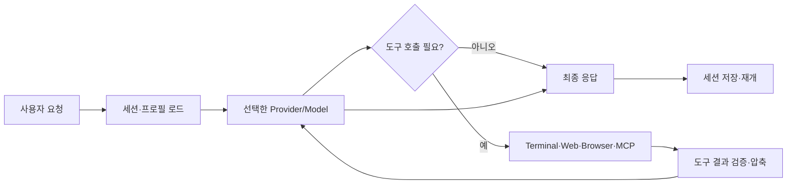
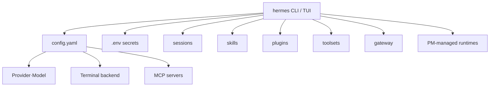
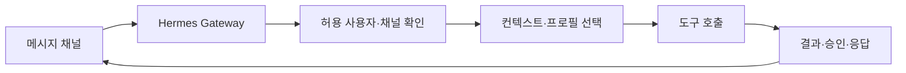
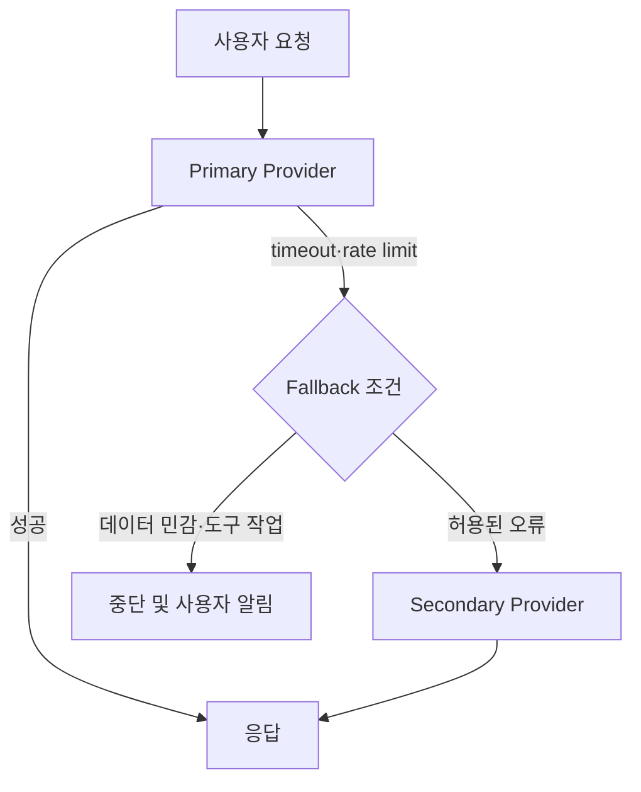

최근 에이전트 도구를 찾아보다가 [Hermes Agent](https://hermes-agent.nousresearch.com/)를 확인했다. 이름만 보면 또 하나의 터미널 챗봇처럼 보이지만, 실제로는 모델을 호출하는 CLI 위에 도구, 스킬, MCP 서버, 메시징 게이트웨이, 세션, 프로필, 자동화를 한 운영 계층으로 묶은 프로젝트에 가깝다.

특히 Claude나 Codex처럼 특정 모델을 직접 사용하는 도구와 달리 Hermes는 **모델을 교체할 수 있는 에이전트 런타임**을 목표로 한다. Nous Portal, OpenAI Codex, Anthropic, OpenRouter, AWS Bedrock, Google, Ollama와 같은 여러 provider를 선택할 수 있고, 같은 세션과 도구 설정을 유지한 채 모델만 바꿀 수 있다.

이 글은 Hermes를 설치했다는 사실보다, 실제로 어떤 경계를 이해해야 안전하게 운영할 수 있는지를 정리한 글이다. CLI 하나를 실행하는 방법에서 시작해 provider, 세션, 도구, 스킬, MCP, gateway, sandbox, 보안, 장애 대응까지 단계적으로 살펴본다.

## Hermes Agent를 한 문장으로 정의하면

Hermes Agent는 **LLM 호출을 중심에 두고, 모델이 사용할 수 있는 도구와 지속적인 작업 문맥을 연결하는 로컬 에이전트 런타임**이다.

일반적인 채팅 앱의 흐름은 다음과 같다.

```text
사용자 질문 → 모델 호출 → 텍스트 응답
```

Hermes의 흐름은 더 길다.



모델은 답변만 생성하는 것이 아니라 터미널을 실행하고, 파일을 읽고, 웹을 검색하고, 브라우저를 조작하고, 사용자가 설치한 스킬의 절차를 따를 수 있다. 따라서 Hermes를 평가할 때는 모델의 벤치마크만 볼 것이 아니라 **도구 권한, 실행 격리, 세션 저장, provider 인증**까지 함께 봐야 한다.

## 설치 전에 알아야 하는 구성 요소

Hermes 설치 후 생기는 것을 하나의 디렉터리로만 생각하면 업데이트나 백업에서 실수하기 쉽다. 공식 문서 기준으로는 다음 계층을 분리해 이해하는 편이 좋다.



- **CLI/TUI**: 대화하고 slash command를 실행하는 인터페이스
- **Provider/Model**: 실제 추론을 수행하는 모델 연결 설정
- **Toolset**: 터미널, 웹 검색, 브라우저, 이미지, TTS, 컴퓨터 제어 등 도구 묶음
- **Skill**: 특정 작업을 수행하는 `SKILL.md` 기반 재사용 절차
- **Plugin**: 기능을 확장하는 패키지 단위
- **MCP server**: 외부 데이터와 도구를 Model Context Protocol로 연결
- **Gateway**: Telegram, Discord, Slack, WhatsApp, Signal, Email, Teams 같은 메시징 채널 연결
- **Session/Profile**: 대화 상태와 설정을 분리해 재개하거나 다른 머신으로 이동
- **PM**: Python, Node.js, browser driver 같은 관리형 실행 환경과 의존성 준비

이 구조의 핵심은 모델과 도구가 분리되어 있다는 점이다. 모델을 Claude에서 Codex로 바꾸더라도 같은 터미널·스킬·MCP 구성을 유지할 수 있다. 반대로 도구 권한을 켜는 순간 모델이 수행할 수 있는 행동의 범위도 넓어진다.

## 설치 방식 선택

### macOS·Windows Desktop

Hermes Desktop 패키지는 에이전트, Python, 의존성, 인터페이스를 함께 제공하는 방식이다. macOS 설치 문서는 Apple Silicon을 지원 대상으로 안내하고 Intel Mac은 지원하지 않는다고 명시한다. Desktop은 로컬에서 바로 쓰기 편하지만, 서버에서 항상 실행되는 자동화에는 CLI나 Docker가 더 적합하다.

### CLI 설치

Linux, macOS, WSL2에서는 공식 설치 스크립트를 사용한다.

```bash
curl -fsSL https://hermes-agent.nousresearch.com/install.sh | bash
source ~/.zshrc
hermes doctor
```

Windows PowerShell에서는 다음 방식이다.

```powershell
iex (irm https://hermes-agent.nousresearch.com/install.ps1)
```

설치 스크립트는 소스 체크아웃과 관리형 런타임을 준비하고 `hermes` launcher를 만든다. POSIX 환경의 기본 소스와 사용자 데이터 위치는 대략 다음과 같다.

```text
소스 체크아웃: ~/.hermes/hermes-agent/
CLI wrapper:   ~/.local/bin/hermes
사용자 데이터: ~/.hermes/
```

실제 운영에서는 시스템 Python이나 전역 Node에 의존하지 않는 것이 중요하다. Hermes 문서는 PM이 고정된 Python·Node·npm·ripgrep·FFmpeg 등을 준비한다고 설명한다. 설치 후 `python` 명령이 가리키는 버전만 보고 Hermes 런타임을 판단하면 안 된다.

### Docker·서비스 사용자

항상 켜두는 gateway나 팀용 봇은 개인 사용자 셸에 설치하는 것보다 별도의 서비스 사용자 또는 Docker 컨테이너로 실행하는 편이 안전하다.

```bash
# 서비스 사용자의 홈을 기준으로 설치
sudo -u hermes -H bash -lc \
  'curl -fsSL https://hermes-agent.nousresearch.com/install.sh | bash'

# 로그아웃 뒤에도 사용자 서비스를 유지해야 한다면
sudo loginctl enable-linger hermes
```

서비스 계정에 실제 필요한 디렉터리 권한과 환경 변수를 부여하고, API 키를 `systemd` unit 파일이나 Docker 이미지에 직접 넣지 않는다.

## 첫 실행은 기능을 많이 켜는 것보다 정상 대화를 확인하는 것이 먼저다

공식 Quickstart의 흐름도 기본 대화가 되기 전에는 gateway, cron, skills, routing을 추가하지 말라고 권한다. 실제 장애를 줄이는 순서는 다음과 같다.

```bash
hermes setup
# 또는 Nous Portal을 빠르게 선택
hermes setup --portal

# 모델·provider 확인
hermes model

# 첫 대화
hermes --tui

# 세션 재개
hermes --continue
```

첫 프롬프트는 결과를 확인하기 쉬워야 한다.

```text
현재 디렉터리에서 프로젝트의 진입점으로 보이는 파일을 찾고 근거를 세 가지로 설명해줘.
파일을 수정하거나 명령을 실행하지 말고 읽기만 해줘.
```

성공 기준은 답변이 나왔다는 것만이 아니다.

- 배너에 선택한 provider와 model이 표시되는가
- 도구가 필요할 때 실제 도구 결과가 대화에 들어오는가
- 두 번 이상 연속 대화가 정상적으로 이어지는가
- `hermes --continue`로 같은 세션을 재개할 수 있는가
- `hermes doctor`가 치명적인 설정 오류를 보고하지 않는가

첫 대화부터 “배포해줘”, “모든 파일을 정리해줘” 같은 넓은 권한을 주면 문제가 생겼을 때 provider 문제인지 도구 문제인지 작업 범위 문제인지 구분하기 어렵다.

## Provider와 Model은 같은 개념이 아니다

Provider는 모델에 접근하는 방식과 인증 경로이고, model은 그 provider에서 선택한 실제 모델 식별자다. 예를 들어 Anthropic API를 provider로 선택하고 특정 Claude 모델을 고를 수 있고, OpenRouter를 provider로 선택해 여러 공급자의 모델을 라우팅할 수 있다.

```text
Provider: openrouter
Model:    anthropic/claude-...
```

Hermes 공식 provider 문서는 Nous Portal, OpenAI Codex, Anthropic, OpenRouter, AWS Bedrock, Google, Vertex, Ollama, LM Studio, custom endpoint 등 다양한 경로를 안내한다. 목록은 버전에 따라 바뀔 수 있으므로 설치 시점의 `hermes model`과 공식 provider 문서를 기준으로 확인해야 한다.

### Nous Portal

Nous Portal은 OAuth 기반의 구독형 경로로, 여러 모델과 Tool Gateway를 하나의 계정으로 사용하도록 구성한다.

```bash
hermes setup --portal
hermes portal info
```

이 방식은 provider별 API 키를 여러 개 관리하지 않아도 되는 장점이 있다. 대신 사용량, 모델 선택, gateway 도구가 구독 정책과 Portal 계정에 연결된다. 회사 데이터나 고객 정보를 넣기 전에 데이터 보관·전송 정책을 확인해야 한다.

### OpenAI Codex와 Anthropic

Hermes는 OpenAI Codex 구독 OAuth와 Anthropic OAuth/API key 경로를 제공한다. 사용 중인 구독이 어떤 모델과 호출 권한을 제공하는지 확인해야 하고, “ChatGPT 로그인”과 “OpenAI API key”는 비용·권한·엔드포인트가 다른 경로일 수 있다.

```bash
hermes model
# OpenAI Codex 또는 Anthropic 경로 선택
```

현재 설정을 자동으로 추측하지 말고 provider 선택 화면에서 모델 ID와 인증 상태를 확인한다. provider가 바뀌었는데도 이전 `base_url`이나 모델 ID가 남아 있으면 응답 형식이 어긋나거나 빈 응답이 올 수 있다.

### 로컬·사설 endpoint

Ollama, vLLM, SGLang, LM Studio처럼 OpenAI-compatible endpoint를 연결할 수도 있다.

```yaml
model:
  provider: custom
  default: local-model
  base_url: http://127.0.0.1:11434/v1
```

로컬 모델을 쓸 때는 context length를 먼저 확인한다. Hermes Quickstart는 최소 64K token context를 요구한다고 안내한다. 로컬 서버의 context가 작으면 짧은 질문은 되더라도 도구 호출·세션 압축·긴 파일 분석에서 실패할 수 있다.

## 설정과 비밀을 분리한다

Hermes는 비밀과 일반 설정을 분리한다.

```text
비밀·토큰: ~/.hermes/.env
일반 설정: ~/.hermes/config.yaml
```

CLI를 이용하면 어느 파일에 넣을지 직접 고민하지 않아도 된다.

```bash
hermes config set model anthropic/claude-opus-4.6
hermes config set terminal.backend docker
hermes config set OPENROUTER_API_KEY 'sk-or-...'
hermes config get model
```

`.env`는 Git에 커밋하지 않는다. Docker를 사용할 때는 호스트 `.env` 전체를 컨테이너에 마운트하는 대신 필요한 키만 secret 또는 환경 변수로 전달한다. 로그에 API key가 출력되지 않는지, provider 오류를 그대로 채팅 transcript에 저장하지 않는지도 확인한다.

프로필을 여러 개 운영하면 개인 실험, 업무, bot 운영 설정을 분리할 수 있다. 다만 profile export는 credential을 제외할 수 있으므로 설정 백업과 인증 백업을 같은 것으로 생각하면 안 된다. 전체 환경 이동은 `hermes backup`, 단일 프로필 이동은 profile export/import 문서를 확인하는 식으로 목적을 나눈다.

## Toolset은 에이전트의 실제 권한이다

모델이 아무리 똑똑해도 도구가 없으면 파일을 읽거나 서버 상태를 확인할 수 없다. 반대로 터미널·브라우저·메시징·컴퓨터 제어를 모두 열면 실수의 영향 범위가 커진다.

```bash
hermes tools
```

도구를 다음처럼 위험도별로 나누어 생각할 수 있다.

| 도구 | 가능해지는 일 | 주요 위험 |
| --- | --- | --- |
| File Operations | 파일 읽기·쓰기 | 비밀 파일·범위 밖 파일 접근 |
| Terminal | 명령 실행·빌드·배포 | 삭제, credential 노출, 외부 전송 |
| Web Search | 최신 문서 조사 | 신뢰하지 않은 지시문, prompt injection |
| Browser | 로그인 사이트·UI 조작 | 계정 변경, 구매, 외부 게시 |
| Image/TTS | 콘텐츠 생성 | 비용, 저작권, 외부 공유 |
| Messaging Gateway | 채널 응답 | 승인 없는 외부 발송 |
| MCP | 사내 DB·GitHub·문서 연결 | 토큰 범위와 데이터 경계 |

처음에는 File Operations와 읽기 전용 검색만 켜고, 실제 작업이 필요할 때 터미널을 추가하는 방식이 안전하다. Hermes 문서의 Blank Slate setup은 도구·스킬·MCP·gateway를 기본 비활성화하고 필요한 것만 선택하도록 한다. 팀 서버나 고객 데이터에 접근하는 환경에서는 이 방식이 출발점이 되어야 한다.

## Terminal backend와 sandbox

Hermes의 터미널은 로컬 프로세스에서 실행할 수도 있고 Docker나 SSH backend로 분리할 수도 있다.

```bash
# Docker sandbox
hermes config set terminal.backend docker

# 별도 서버에서 실행
hermes config set terminal.backend ssh
```

여기서 Docker가 있다고 해서 자동으로 안전해지는 것은 아니다. 컨테이너에 소켓(`/var/run/docker.sock`), 홈 디렉터리, SSH 키, cloud credential을 마운트하면 격리 의미가 사라진다. 다음을 별도로 결정해야 한다.

- 작업 디렉터리만 read-only로 줄지, 쓰기를 허용할지
- 네트워크 egress를 모두 허용할지 도메인 allowlist로 제한할지
- GitHub token을 sandbox에 직접 넣을지 proxy를 사용할지
- 컨테이너가 호스트 Docker daemon에 접근할 수 있는지
- 실패한 작업을 어떻게 삭제·복구할지

Hermes 문서에는 egress credential-injection proxy가 안내되어 있다. 이 구조에서는 sandbox가 실제 API 키를 보지 않고 proxy를 통해 허용된 호출만 수행하도록 만들 수 있다. 다만 이것도 설정이 완료됐다는 사실만으로 안전하다고 보지 말고, 실제 네트워크 경로와 로그를 검증해야 한다.

## Session은 단순한 채팅 기록이 아니다

`hermes --continue`로 대화를 이어갈 수 있다는 것은 이전 메시지를 다시 보여준다는 뜻 이상이다. provider, 프로필, 도구 설정, 작업 디렉터리, 압축된 문맥이 현재 작업과 연결될 수 있다.

```bash
hermes sessions list
hermes --continue
hermes -c
```

세션을 재개할 때 확인할 항목은 다음과 같다.

1. 같은 profile에서 실행하는가
2. 이전과 같은 작업 디렉터리인가
3. provider와 model이 바뀌지 않았는가
4. 이전 세션에서 사용한 MCP와 skill이 아직 설치되어 있는가
5. 오래된 세션에 포함된 권한·토큰·지시가 지금도 유효한가

오래된 세션을 무조건 이어가면 과거의 잘못된 가정이 새 작업에 섞일 수 있다. 운영 작업은 새 세션에서 현재 상태를 다시 확인하고, 조사·설계 작업은 이전 세션을 재개하는 식으로 구분한다.

## Skills는 프롬프트 모음이 아니라 실행 절차다

Hermes의 skill은 이름과 설명을 먼저 보여주고 실제 요청이 해당 skill과 맞을 때 상세한 `SKILL.md`를 읽는 구조다. 따라서 모든 skill 내용을 매 요청에 붙여 넣는 방식보다 context를 절약할 수 있다.

```bash
hermes skills browse
hermes skills search kubernetes
hermes skills install openai/skills/k8s
```

Skill은 다음을 포함할 수 있다.

- 어떤 상황에서 적용하는가
- 사전 확인할 파일과 상태
- 사용할 도구와 금지할 도구
- 실행 순서
- 검증 명령과 실패 시 복구 절차
- 사용자가 직접 승인해야 하는 단계

좋은 skill은 “Kubernetes 배포해”처럼 짧은 명령을 위험한 실행으로 바꾸지 않는다. 현재 context와 namespace, 이미지 tag, diff, rollout 상태를 먼저 확인하고 승인이 필요한 지점을 분리한다.

커스텀 skill을 만들 때는 다음처럼 범위를 좁힌다.

```markdown
---
name: release-check
---

# Release Check

1. 현재 브랜치와 변경 파일을 읽는다.
2. 테스트와 빌드 결과를 확인한다.
3. 배포 대상과 환경을 사용자에게 요약한다.
4. 외부 배포는 명시적 승인이 있을 때만 실행한다.
5. 배포 후 URL과 로그를 검증한다.
```

Skill을 설치할 때는 실행 가능한 명령, 외부 URL, credential 요구사항을 검토한다. 공식 문서도 skill install 시 보안 스캔을 수행한다고 설명하지만, 자동 스캔을 사람의 검토 대신으로 사용하면 안 된다.

## MCP는 연결이 아니라 권한 계약이다

Hermes는 `config.yaml`에 MCP 서버를 등록해 외부 도구를 연결할 수 있다.

```yaml
mcp_servers:
  github:
    command: npx
    args: ["-y", "@modelcontextprotocol/server-github"]
    env:
      GITHUB_PERSONAL_ACCESS_TOKEN: "${GITHUB_PERSONAL_ACCESS_TOKEN}"
```

실제 설정에서 token을 문자열로 직접 적지 말고 환경 변수나 secret manager를 사용한다. MCP 서버마다 다음을 문서화한다.

- 읽기만 가능한가, 쓰기 작업이 있는가
- 접근 가능한 repository·조직·테이블 범위
- 호출 결과에 개인정보나 비밀이 포함될 수 있는가
- 외부 네트워크로 데이터를 보내는가
- timeout과 재시도 정책은 무엇인가
- 도구 이름과 인자가 바뀌었을 때 어떻게 감지하는가

MCP 도구는 모델이 호출할 수 있는 API다. “대화 중 자연어로 실행되니 안전하다”는 보장은 없다. 삭제·메일 발송·결제·배포 도구는 읽기 도구와 분리하고, 가능하면 별도 profile에서만 노출한다.

## Gateway: CLI 에이전트를 메시징 봇으로 바꾸기

기본 CLI가 안정화된 후 `hermes gateway setup`을 실행하면 Telegram, Discord, Slack, WhatsApp, Signal, Email, Microsoft Teams 같은 플랫폼과 연결할 수 있다.

```bash
hermes gateway setup
hermes gateway status
```

Gateway를 연결하면 메시지 한 줄이 작업 요청이 된다. 이때 위험 모델이 로컬 CLI보다 커진다.



반드시 정해야 하는 정책은 다음과 같다.

- 허용 사용자와 채널 allowlist
- 그룹 채팅에서 봇이 반응할 조건
- 명령어별 승인 필요 여부
- 파일 첨부와 URL 처리 정책
- 개인 대화와 팀 채널의 세션 분리
- 봇이 보낼 수 있는 메시지와 외부 작업 범위
- gateway 재시작과 중복 메시지 처리

“내 Telegram만 연결했으니 안전하다”라고 생각하기 쉽지만, 계정 탈취·잘못된 채널 초대·메시지 spoofing·링크 prompt injection을 고려해야 한다. 항상 먼저 읽기 전용 명령으로 테스트하고, 배포나 외부 발송은 별도 승인 단계를 둔다.

## Provider routing과 fallback은 마지막에 추가한다

여러 provider를 연결하면 한 provider가 실패할 때 다른 모델로 전환할 수 있다. 하지만 처음부터 fallback을 켜면 문제가 더 어려워진다.



fallback을 설계할 때는 단순히 “다른 모델이면 된다”고 볼 수 없다.

- 새 provider가 같은 tool calling 형식을 지원하는가
- context length가 충분한가
- vision·JSON schema·MCP 도구를 지원하는가
- 데이터가 다른 지역·사업자로 전송되는가
- 비용과 rate limit이 예상 범위인가
- 이전 provider가 일부 작업을 실행한 뒤 재시도하는가

파일 수정이나 결제처럼 side effect가 있는 작업은 provider timeout만 보고 바로 재시도하면 중복 실행될 수 있다. 작업 ID와 idempotency key를 기록하고, 실행 전후 상태를 확인한 뒤 재시도한다.

## 자동화와 Cron은 정상 대화 이후에 붙인다

Hermes는 cron이나 always-on workflow를 지원하지만, 기본 채팅이 안정화되지 않은 상태에서 자동화를 추가하면 야간에 실패를 반복하는 시스템이 된다.

자동화 작업에는 최소한 다음을 넣는다.

```text
작업 이름: daily-report
실행 조건: 평일 10:00 KST
입력: 읽기 전용 통계 API
출력: 초안 파일 생성
금지: 외부 발송·삭제·배포
실패 시: 로그 기록과 관리자 알림
재실행: 날짜 키로 중복 방지
```

자동화는 “정해진 시간에 prompt를 보내는 기능”이 아니라 입력, 권한, 결과 저장, 실패 복구까지 포함한 운영 프로세스다. 특히 gateway와 cron을 함께 사용하면 같은 작업이 중복 실행되는지 확인한다.

## 보안 모델: Hermes가 할 수 있는 일보다 못 하게 만드는 것이 중요하다

Hermes는 파일·터미널·브라우저·MCP를 연결할 수 있으므로 일반적인 챗봇보다 권한이 크다. 최소 권한 원칙을 다음 레벨로 적용한다.

### 계정과 파일

- 개인 홈 전체가 아니라 작업 디렉터리만 노출한다.
- `.env`, SSH key, cloud credential, browser profile을 기본 제외한다.
- 읽기와 쓰기 workspace를 분리한다.
- Git 작업은 별도 branch와 worktree에서 실행한다.

### 네트워크

- 기본 egress를 필요한 도메인으로 제한한다.
- browser와 terminal이 같은 proxy를 공유하는지 확인한다.
- 내부망 주소와 metadata endpoint 접근을 차단한다.
- 외부 URL에서 내려온 지시문을 시스템 지시로 신뢰하지 않는다.

### 실행

- 삭제·배포·메일·결제는 승인 단계로 분리한다.
- shell 명령은 실행 전 dry-run 또는 설명을 요구한다.
- Docker socket과 privileged container를 피한다.
- 로그와 세션에 비밀이 저장되지 않도록 redaction을 적용한다.

### 공급자

- 모델 provider별 데이터 사용 정책을 확인한다.
- 팀 개인정보가 개인 provider 계정으로 전송되지 않게 한다.
- fallback이 데이터를 다른 provider로 보내는지 문서화한다.
- API key와 OAuth refresh token의 만료·폐기 절차를 마련한다.

## 문제를 찾는 순서

Hermes가 “설치됐는데 답하지 않는다”면 무작정 다시 설치하기보다 다음 순서를 따른다.

```bash
hermes doctor
hermes model
hermes setup
hermes sessions list
hermes --continue
hermes gateway status
```

대표적인 원인은 다음과 같다.

| 증상 | 가능한 원인 | 확인 방법 |
| --- | --- | --- |
| `command not found` | PATH가 갱신되지 않음 | `source ~/.zshrc`, `which hermes` |
| 빈 응답·깨진 응답 | provider/model/auth 불일치 | `hermes model`, provider 로그 |
| custom endpoint 오류 | base URL·model·호환 API 불일치 | 별도 curl로 endpoint 확인 |
| gateway가 응답하지 않음 | token·allowlist·채널 설정 | `hermes gateway status` |
| 세션 재개 실패 | profile 변경·저장 실패 | `hermes sessions list` |
| update 후 설정 문제 | config migration 필요 | `hermes config check`, `config migrate` |
| 브라우저 도구 실패 | driver·OS dependency 문제 | browser 설치 상태와 로그 확인 |

로그의 마지막 오류만 보고 provider를 바꾸면 원인을 가릴 수 있다. 먼저 config와 인증을 확인하고, 도구를 하나씩 끈 최소 구성에서 대화를 재현한다.

## 운영 체크리스트

### 처음 설치할 때

- [ ] 공식 설치 경로와 지원 OS를 확인했다.
- [ ] `hermes doctor`가 통과했다.
- [ ] 최소 64K context 모델을 선택했다.
- [ ] provider·model·인증 상태를 기록했다.
- [ ] `.env`와 `config.yaml`의 저장 위치를 확인했다.

### 도구를 추가할 때

- [ ] 읽기·쓰기·외부 실행 권한을 분리했다.
- [ ] terminal backend와 workspace 범위를 정했다.
- [ ] MCP token scope와 데이터 전송 경계를 문서화했다.
- [ ] skill의 명령과 외부 URL을 검토했다.
- [ ] 삭제·배포·발송 작업에 승인이 필요한가 결정했다.

### Gateway·자동화 전에

- [ ] CLI에서 두 번 이상 정상 대화가 됐다.
- [ ] 허용 사용자·채널 allowlist가 있다.
- [ ] 대화 세션과 업무 세션을 분리했다.
- [ ] 중복 실행·timeout·재시도 정책이 있다.
- [ ] 장애 시 작업을 중단하고 로그를 남길 방법이 있다.

## Hermes를 어떤 사람에게 권할까

Hermes는 모델 하나를 정해 대화하는 앱보다, 다음과 같은 사용 사례에서 가치가 크다.

- 로컬 저장소를 읽고 반복적인 개발 작업을 수행하는 개인 개발자
- 여러 provider를 시험하면서 도구와 세션은 유지하려는 팀
- Slack·Telegram·Discord에서 공용 보조 에이전트를 운영하려는 조직
- MCP와 skill을 조합해 팀의 반복 절차를 표준화하려는 조직
- 로컬·사설 endpoint와 외부 provider를 한 인터페이스에서 비교하려는 사용자

반대로 단순 질의응답이나 민감한 사내 데이터를 별도 통제 없이 넣는 용도라면 기능이 많다는 점이 오히려 부담이다. 도구·gateway·MCP를 쓰지 않는다면 단순한 채팅 인터페이스나 제한된 코딩 에이전트가 더 적합할 수 있다.

Hermes의 핵심은 “더 많은 도구를 켜는 것”이 아니다. **모델 선택, 실행 권한, 작업 문맥, 검증 절차를 한 설정 체계로 관리하는 것**이다. 이 경계를 잡아두면 Claude, Codex, 오픈 모델, 사내 endpoint를 교체해도 업무 흐름은 유지할 수 있다. 반대로 권한과 데이터 경계를 문서화하지 않으면 모델을 바꾸는 순간뿐 아니라 skill·MCP·gateway를 추가하는 순간마다 새로운 보안 문제가 생긴다.

## 참고 자료

- [Hermes Agent Quickstart](https://hermes-agent.nousresearch.com/docs/getting-started/quickstart)
- [Hermes Agent Installation](https://hermes-agent.nousresearch.com/docs/getting-started/installation)
- [LLM and Model Providers](https://hermes-agent.nousresearch.com/docs/integrations/providers)
- [Hermes Agent GitHub 저장소](https://github.com/NousResearch/hermes-agent)
- [Hermes Agent Skills](https://hermes-agent.nousresearch.com/docs/features/skills)
- [Hermes Agent Messaging Gateway](https://hermes-agent.nousresearch.com/docs/messaging/gateway)
- [Hermes Agent MCP Integrations](https://hermes-agent.nousresearch.com/docs/integrations/mcp)

Hermes의 provider 목록과 설치 방식, 지원 플랫폼은 빠르게 바뀔 수 있으므로 실제 설치·운영 전에는 현재 공식 문서를 확인해야 한다.
