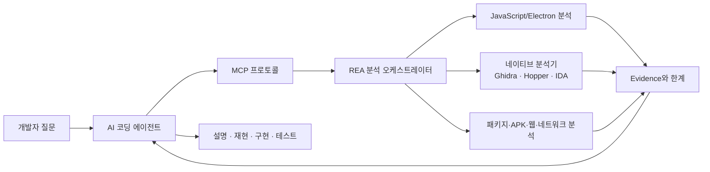
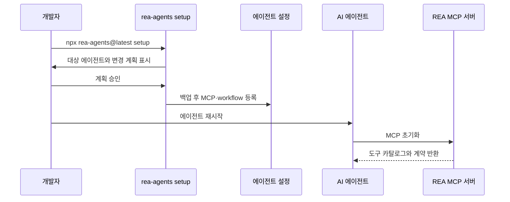
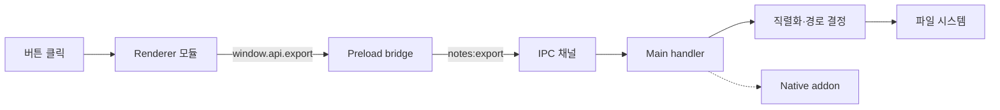
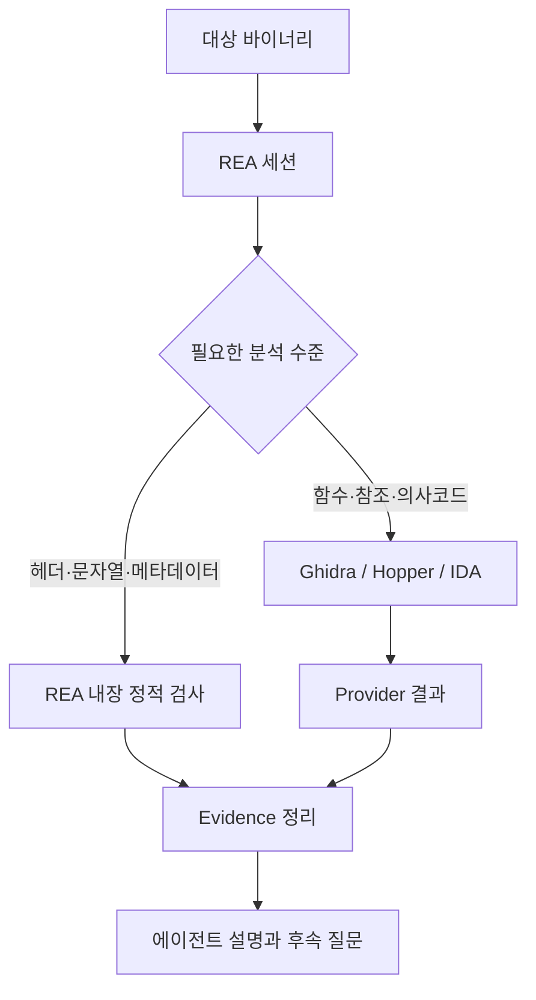
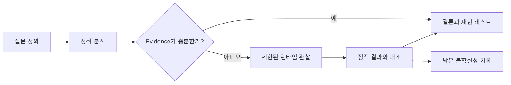

최근 AI 코딩 에이전트는 소스 저장소 안의 코드를 읽고 수정하는 수준을 넘어, 이미 배포된 애플리케이션이 실제로 어떻게 동작하는지 조사하는 단계로 확장되고 있다. REA(Reverse Engineer Anything)는 이 문제를 다루는 도구다. 이름 그대로 무엇이든 무작정 분해한다는 뜻이 아니라, 에이전트가 역공학 도구와 분석 결과를 연결해 **관찰 가능한 근거를 바탕으로 소프트웨어의 동작을 설명하도록 만드는 인터페이스**에 가깝다.

REA는 단일 디컴파일러가 아니다. JavaScript와 Electron 애플리케이션은 모듈·라우트·IPC·네이티브 애드온 관계를 추적하고, 네이티브 바이너리는 Hopper·Ghidra·IDA와 연결해 함수·문자열·참조·호출 관계를 조사한다. Android APK, .NET 어셈블리, 웹사이트, 네트워크 캡처, WASM, SQLite, 펌웨어 등은 대상별 분석기가 제공하는 결과를 하나의 에이전트 흐름으로 묶는다. 공식 문서도 분석 결과에 근거와 한계를 함께 포함한다고 설명한다. 이 글은 REA를 설치하는 법보다, 어떤 문제에 어떤 분석 경로를 선택하고 결과를 어떻게 검증해야 하는지에 초점을 맞춘다.

## REA를 한 문장으로 정의하면

REA는 **AI 에이전트와 로컬 역공학 도구 사이에서 질문, 분석, 증거, 후속 작업을 연결하는 MCP 기반 분석 계층**이다. 사용자는 “이 앱에서 메모가 CSV로 저장되는 흐름을 찾아줘”라고 질문하고, 에이전트는 REA의 도구를 호출해 파일·모듈·호출 관계를 단계적으로 확인한다. 결과에는 단순한 결론만 아니라 어떤 파일과 심볼, IPC 채널, 디컴파일 결과를 근거로 삼았는지가 포함된다.



이 구조에서 에이전트는 분석 엔진 자체가 아니다. 에이전트는 질문을 분해하고 어떤 도구를 호출할지 결정하며 결과를 사람이 읽을 수 있는 설명과 다음 작업으로 연결한다. REA는 파일을 읽고 그래프를 만들고 분석기에서 결과를 가져오는 역할을 담당한다. 따라서 분석 품질은 모델의 추론 능력뿐 아니라 대상 식별, provider 준비, Evidence의 범위, 실행 여부에 의해 결정된다.

## 소스 코드 분석과 역공학은 출발점이 다르다

일반적인 저장소 분석은 개발자가 작성한 소스, 테스트, 설정 파일을 기준으로 구조를 파악한다. 반면 역공학은 배포된 결과물에서 관찰 가능한 사실을 복원한다. 번들링과 난독화, 소스맵 누락, 네이티브 경계, 런타임 로딩 때문에 원래의 클래스 이름이나 디렉터리 구조가 그대로 남아 있지 않을 수 있다.

예를 들어 Electron 앱의 “내보내기” 기능을 조사한다고 하자. 소스 저장소가 있다면 `exportNotes()`를 검색하면 되지만, 설치된 앱만 있다면 다음 질문을 나눠야 한다.

1. 버튼 이벤트는 어떤 renderer 모듈에서 시작되는가?
2. preload가 어떤 IPC 채널을 노출하는가?
3. main process가 어떤 핸들러를 등록하는가?
4. 파일 경로와 CSV 직렬화는 어느 모듈에서 결정되는가?
5. 네이티브 애드온이나 운영체제 API가 마지막에 관여하는가?
6. 정적 분석으로 확인되지 않는 값은 런타임에서 검증해야 하는가?

REA의 장점은 이 질문들을 단순한 문자열 검색으로 끝내지 않고, 모듈 그래프와 호출 관계, Evidence를 엮어 조사할 수 있다는 데 있다. 다만 정적 분석 결과만으로 실행 시점의 모든 동작을 확정해서는 안 된다. 공식 가이드도 정적 분석은 애플리케이션을 실행하지 않고 공급된 파일을 읽으며, 런타임 캡처는 사용자의 권한으로 대상 프로세스를 실행하거나 상호작용한다고 구분한다.

## 설치와 연결: 먼저 에이전트 등록을 이해한다

REA의 공식 시작점은 `rea-agents` 패키지다. Node.js 22.19 이상, 24.11 이상 또는 26 이상과 npm이 필요하다. 가장 간단한 연결은 다음 명령이다.

```bash
npx rea-agents@latest setup
```

설치 과정에서 Codex, Claude Code, Cursor, Gemini CLI 등 사용할 에이전트를 선택하고 변경 계획을 확인한다. setup은 기존 설정을 백업한 뒤 REA MCP 서버와 분석용 workflow instruction을 등록한다. 설정이 끝나면 에이전트를 재시작해야 새 MCP 서버와 스킬이 인식된다.

설정 후 직접 CLI를 사용하고 싶다면 전역 설치를 할 수 있다.

```bash
npm install --global rea-agents
rea --help
rea update
```

일회성 실행에는 `npx -y rea-agents@latest`를 계속 사용할 수 있다. 버전이 빠르게 바뀌는 도구이므로 오류가 발생했을 때는 임의로 설정 파일을 지우기보다 먼저 최신 버전으로 갱신하고, 에이전트 등록을 다시 확인하는 편이 안전하다.



REA가 보이지 않는다면 원인은 크게 세 가지다. 에이전트가 재시작되지 않았거나, 다른 Node 환경에서 setup을 실행했거나, MCP 등록 경로가 현재 사용하는 클라이언트와 다를 수 있다. 이때 설치를 반복하기보다 해당 에이전트의 MCP 목록, `rea-agents` 버전, Node 경로를 먼저 확인해야 한다.

## 첫 분석은 대상과 질문을 작게 잡는다

역공학 도구를 처음 사용할 때 “이 앱을 전부 분석해줘”라고 요청하면 결과가 너무 커지고 검증 기준도 사라진다. 첫 질문은 하나의 기능, 하나의 진입점, 하나의 결과로 제한하는 것이 좋다. 예를 들면 다음과 같다.

```text
이 Electron 앱에서 노트를 CSV로 내보내는 흐름을 조사해줘.
renderer의 버튼 이벤트부터 preload IPC, main process 핸들러, 파일 쓰기까지
정적 Evidence를 단계별로 보여줘. 확인되지 않은 런타임 동작은 추정하지 말고
추가로 필요한 관찰을 구분해줘.
```

질문에 “Evidence”, “확인되지 않은 부분”, “정적 분석인지 런타임 관찰인지”를 포함하면 결과가 훨씬 검증 가능해진다. 기능 이름만 주는 것보다 실제 문자열, IPC 채널명, 파일명, 버튼 라벨처럼 진입점을 제공하는 것도 효과적이다.

대상 경로는 반드시 절대 경로로 지정하는 편이 좋다. 특히 에이전트가 실행되는 환경과 REA CLI가 실행되는 환경이 다르면 `/Users/...`와 `/workspaces/...`가 서로 다른 파일을 가리킬 수 있다. 분석 보고서에는 대상의 경로뿐 아니라 파일 해시나 버전, 플랫폼을 함께 기록해야 버전 비교가 가능하다.

## JavaScript와 Electron 분석 흐름

JavaScript 앱은 소스가 남아 있지 않아도 번들 내부에 모듈과 문자열, 소스맵, Electron 경계가 일부 보존될 수 있다. REA의 JavaScript 분석 명령은 애플리케이션 디렉터리나 ASAR를 대상으로 사용할 수 있다.

```bash
npx -y rea-agents@latest analyze-javascript-application \
  /absolute/path/to/app \
  --json
```

결과의 핵심은 단순한 파일 목록이 아니라 연결 그래프다. 일반적인 Electron 구조는 renderer, preload, main process 세 영역으로 나뉜다.

- renderer: 화면 이벤트와 사용자 입력을 처리한다.
- preload: 제한된 API를 `contextBridge`로 노출하고 IPC 메시지를 전달한다.
- main: 파일 시스템, 윈도우, 프로세스, 운영체제 API를 다룬다.
- native addon: C/C++ 또는 Rust로 작성된 모듈이 별도 경계로 연결될 수 있다.



REA 가이드의 예시처럼 문자열이나 API 이름, IPC 채널명을 단서로 기능을 추적할 수 있다. 다만 번들 파일에서 `export`라는 문자열이 발견됐다는 사실만으로 실제 버튼과 연결됐다고 결론 내리면 안 된다. import/export 관계, 호출 위치, IPC 등록과 핸들러를 차례로 확인해야 한다.

패키지에 ASAR가 있다면 먼저 원본을 보존하고 복사본을 대상으로 분석한다. 분석 도중 파일을 추출하거나 변환할 때 원본과 결과물의 해시를 기록하면 비교가 쉬워진다. 소스맵이 존재할 때는 매핑된 원본 위치가 유용하지만, 소스맵의 정확성과 공개 범위도 함께 확인해야 한다.

## 네이티브 바이너리: REA와 분석 provider의 경계

네이티브 실행 파일 분석은 REA가 모든 디컴파일 기능을 직접 제공하는 방식이 아니다. Hopper, Ghidra, IDA 같은 분석 provider를 연결하고 REA가 해당 도구를 에이전트의 MCP 흐름으로 노출한다. 일부 정적 포맷은 provider 없이도 헤더·섹션·메타데이터를 읽을 수 있지만, 함수 의사코드와 호출 그래프에는 적합한 엔진이 필요하다.

이 경계는 운영 측면에서 중요하다. REA 설치가 완료되어도 Ghidra나 IDA가 설치되어 있지 않거나, 라이선스·환경 변수·프로세스 권한이 준비되지 않으면 깊은 네이티브 분석은 시작되지 않는다. 반대로 JavaScript와 .NET의 정적 분석은 네이티브 엔진 없이도 가능한 범위가 있다.



분석 결과를 읽을 때는 의사코드를 원본 소스와 동일하게 취급하면 안 된다. 디컴파일러는 레지스터와 메모리 흐름을 사람이 읽기 좋은 형태로 추정할 뿐이며, 컴파일러 최적화와 타입 손실 때문에 변수 이름·제어 흐름·자료형이 달라질 수 있다. 중요한 동작은 어셈블리, 문자열 참조, 호출자와 피호출자, 독립적인 테스트 결과를 함께 확인해야 한다.

## Android와 패키지 분석

REA는 APK의 manifest 선언, 클래스, 디컴파일된 메서드, 참조를 조사할 수 있다. Android 분석에는 headless JADX와 JDK가 필요할 수 있고, 리소스 분석에는 Apktool이 사용된다. 실제 기기와 상호작용하는 분석은 별도의 `adb` 환경과 사용자 권한이 필요하다.

정적 APK 분석과 기기 런타임 관찰은 질문이 다르다. manifest와 dex를 보면 선언된 컴포넌트와 문자열, 클래스 관계를 확인할 수 있지만, 서버 응답에 따라 달라지는 화면이나 암호화 후의 네트워크 흐름은 정적 결과만으로 확정하기 어렵다. 기기 분석을 요청할 때는 대상 패키지, 실행할 액션, 캡처 범위를 명시하고 필요 이상의 로그나 파일을 수집하지 않아야 한다.

예를 들어 “로그인 버튼이 무엇을 호출하는가?”라는 질문은 다음처럼 단계화할 수 있다.

1. APK manifest에서 exported activity와 권한을 확인한다.
2. JADX 결과에서 버튼 리소스와 클릭 리스너를 찾는다.
3. 호출되는 ViewModel·Repository·HTTP client 관계를 추적한다.
4. 정적 결과에서 누락된 동적 URL이나 토큰 처리는 런타임 관찰 대상으로 분리한다.
5. 관찰 결과가 실제 소유한 테스트 계정과 테스트 환경에서만 발생하도록 범위를 제한한다.

## Evidence가 보고서의 핵심이다

REA를 단순히 “AI가 앱을 분석해주는 도구”라고 부르면 중요한 부분을 놓치게 된다. 신뢰할 수 있는 결과는 결론보다 근거를 먼저 보여줘야 한다. 하나의 finding에는 최소한 다음 정보가 필요하다.

| 항목 | 기록할 내용 |
| --- | --- |
| 대상 | 파일 경로, 패키지, 버전, 해시 |
| 질문 | 어떤 기능이나 관계를 확인하려 했는가 |
| 분석 방식 | 정적, 런타임, provider 기반 여부 |
| 근거 | 모듈·심볼·문자열·IPC·로그·스크린샷 위치 |
| 결론 | Evidence로 직접 확인된 사실 |
| 미확인 | 실행 조건, 난독화, 누락된 심볼 등 |
| 다음 단계 | 추가 정적 탐색, 재현 테스트, 런타임 관찰 |

이 구분을 지키면 “문자열이 존재한다”와 “사용자 입력에서 해당 문자열이 실제로 호출된다”를 혼동하지 않게 된다. 특히 런타임 Evidence가 없는 상태에서 서버 통신, 권한 상승, 암호화 키 사용을 단정하면 보고서가 위험해진다.

```text
관찰: preload 번들에서 "notes:export" 채널을 contextBridge에 노출함
근거: preload.js의 bridge 객체와 main.js의 ipcMain.handle 등록 위치
추론: renderer가 이 API를 호출하면 main process로 전달될 가능성이 있음
미확인: 실제 버튼 클릭 시 호출되는지, 파일 쓰기가 성공하는지
다음: renderer 호출자를 추적하고 소유한 테스트 앱에서 한 번의 실행을 캡처
```

## MCP로 연결될 때 달라지는 점

CLI는 명령을 직접 실행하고 JSON이나 사람이 읽는 결과를 받는 방식이다. MCP 연결은 에이전트가 도구 목록과 입력 스키마를 보고 질문에 맞는 도구를 선택하는 방식이다. REA는 기본적으로 컨텍스트 사용량을 줄이는 compact input schema를 제공하며, 전체 필드 설명과 중첩 검증 정보가 필요한 경우 `REA_MCP_INPUT_SCHEMA_PROFILE=full`을 MCP 등록에 설정할 수 있다고 안내한다.

MCP가 연결되었다고 해서 에이전트가 모든 분석을 자동으로 정확하게 수행하는 것은 아니다. 도구 설명이 모호하면 잘못된 provider를 고르거나, 같은 검색을 반복하거나, 결과가 충분하지 않은데 결론을 먼저 낼 수 있다. 따라서 프롬프트에 대상·질문·Evidence 형식·금지 범위를 함께 적는 것이 중요하다.

```text
대상: /absolute/path/to/notes-app.asar
범위: 메모 내보내기 기능만
목표: renderer -> preload -> main -> 파일 쓰기 경로
출력: 단계별 Evidence, 확인된 사실, 미확인 사항, 다음 조사 명령
제약: 대상 파일을 수정하지 말고, 런타임 실행은 하지 말 것
```

운영 환경에서는 MCP 설정에 민감한 경로와 분석 결과가 어떤 모델 provider로 전달되는지도 확인해야 한다. REA 분석은 로컬에서 수행되지만, 도구 결과를 받은 에이전트와 그 모델 provider의 데이터 정책은 별개다. 사내 앱이나 고객 데이터를 분석할 때는 파일 반출 정책, 로그 보존, 모델 provider의 학습·보관 정책을 검토해야 한다.

## 정적 분석과 런타임 분석을 섞는 방법

정적 분석은 빠르고 반복 가능하며 대상 파일을 실행하지 않는다는 장점이 있다. 런타임 관찰은 실제 값과 프로세스 상호작용을 확인할 수 있지만, 실행에 따른 파일·네트워크·프로세스 변화가 발생한다. 두 방식은 경쟁 관계가 아니라 서로 다른 불확실성을 줄인다.



예를 들어 “앱이 클립보드의 서식을 어떻게 보존하는가?”를 조사할 때 정적 분석으로 renderer API와 preload IPC, main process의 clipboard 호출을 찾을 수 있다. 그러나 실제로 HTML과 RTF 중 어떤 형식을 우선하는지는 런타임에서 클립보드 상태를 통제한 테스트가 필요할 수 있다. 이때 테스트 데이터, 실행 횟수, OS 버전, 결과 파일을 기록해야 관찰을 재현할 수 있다.

런타임 분석은 반드시 소유하거나 분석 권한이 있는 대상에서 수행해야 한다. 네트워크 캡처나 프로세스 관찰에는 개인정보와 인증 토큰이 포함될 수 있으므로, 테스트 계정과 격리된 환경을 사용하고 결과 공유 전에 민감한 값을 제거해야 한다.

## 버전 비교와 회귀 분석

REA는 한 버전의 구조를 설명하는 데서 끝나지 않고, 두 패키지나 두 실행 결과의 차이를 추적하는 데도 사용할 수 있다. 비교할 때는 파일명이 바뀌었다는 사실보다 기능 경로의 변화에 집중해야 한다.

- 동일한 진입점의 모듈 연결이 바뀌었는가?
- IPC 채널, route, 권한 선언이 추가 또는 제거되었는가?
- native addon의 ABI나 의존성이 달라졌는가?
- 네트워크 요청의 호스트와 payload 구조가 달라졌는가?
- 보안 완화 옵션과 서명·패키징 메타데이터가 바뀌었는가?

비교 보고서는 “버전 A에 없고 버전 B에 있다”는 목록보다 “어떤 기능 질문에 어떤 Evidence 차이가 있는가”로 작성하는 편이 개발과 보안 대응에 유용하다. 변경이 의도된 것인지 확인하려면 릴리스 노트, 테스트, 소유 팀의 설계 문서와도 대조해야 한다.

## 보안과 합법적 사용 범위

역공학 도구는 소프트웨어 보존, 상호운용성, 보안 점검, 장애 분석, 교육, 자신의 제품 이해에 유용하다. 동시에 제3자 소프트웨어의 무단 분석, 라이선스 우회, 자격 증명 추출, 취약점 악용에 사용될 수 있다. REA 공식 문서도 자신이 소유하거나 분석 권한을 받은 소프트웨어를 합법적인 연구·교육·상호운용성·보존 목적으로 분석해야 한다고 명시한다.

실무에서 지켜야 할 최소 기준은 다음과 같다.

1. 분석 대상의 소유권 또는 명시적인 분석 권한을 확인한다.
2. 원본을 보존하고 복사본에서 정적 분석을 수행한다.
3. 런타임 관찰은 격리된 테스트 환경과 테스트 계정으로 제한한다.
4. 네트워크 캡처와 로그에서 토큰, 개인정보, 내부 주소를 제거한다.
5. 상용 provider와 디컴파일러의 라이선스 조건을 지킨다.
6. 분석 결과를 제품 코드에 반영할 때 관찰된 동작과 새로 선택한 설계를 구분한다.
7. 취약점이 발견되면 공개 전에 소유자와 조정된 신고 절차를 따른다.

REA를 설치하는 행위가 분석 권한을 부여하는 것은 아니다. 도구가 할 수 있는 범위와 사용자가 해도 되는 범위는 별개의 문제다.

## 자주 생기는 실패와 회복 순서

| 증상 | 가능한 원인 | 확인 순서 |
| --- | --- | --- |
| 에이전트가 REA 도구를 못 봄 | MCP 등록 후 재시작하지 않음 | 에이전트 재시작, MCP 목록 확인 |
| setup은 됐지만 CLI가 다른 버전임 | Node/npm 환경이 다름 | `which node`, `npm ls -g rea-agents` 확인 |
| JavaScript 분석이 실패함 | 경로가 ASAR 또는 앱 루트가 아님 | 복사본·추출 경로·권한 확인 |
| 네이티브 분석 provider가 없음 | Ghidra/Hopper/IDA 미설치 또는 미연결 | provider별 설치와 readiness 확인 |
| 결과가 너무 일반적임 | 질문 범위와 진입점이 넓음 | 기능·문자열·IPC 채널로 질문 축소 |
| 분석 결과와 실행 결과가 다름 | 정적 추론을 런타임 사실로 오해 | 실행 조건과 Evidence 타입 분리 |
| Linux에서 프로세스 확인 실패 | `ps` 또는 procps 호환 환경 부족 | REA PATH와 procps 설치 확인 |

업데이트가 필요한 경우에는 전역 설치라면 다음처럼 실행한다.

```bash
rea update
```

`npx` 방식으로 setup했다면 다음 명령으로 에이전트 등록과 workflow를 새 버전에 맞춘다.

```bash
npx rea-agents@latest setup
```

문제가 반복되면 버전, 대상 종류, 실행한 명령, 전체 오류 출력, 운영체제와 Node 버전을 함께 기록해 재현 가능한 이슈로 만든다. “안 된다”는 설명보다 어느 단계에서 어떤 Evidence가 생성되지 않았는지를 적는 것이 해결에 훨씬 유리하다.

## REA를 도입하기 좋은 팀과 작업

REA는 모든 개발 작업의 기본 도구가 아니다. 소스 저장소가 충분하고 일반적인 리팩터링을 하는 상황이라면 `rg`, IDE, 테스트, 빌드 도구가 더 빠르다. 반면 다음과 같은 상황에서는 REA의 가치가 크다.

- 소스가 없거나 오래된 설치 패키지만 남아 있는 레거시 앱
- Electron renderer와 main process 사이의 IPC 흐름 조사
- 보안 점검에서 패키지·바이너리·권한 관계를 확인하는 작업
- SDK나 파일 포맷의 상호운용성을 구현해야 하는 작업
- 릴리스 버전 간 native dependency와 동작 차이를 비교하는 작업
- 소프트웨어 보존과 테스트를 위해 기존 동작을 재현해야 하는 작업

도입할 때는 “도구를 설치했는가”보다 “조사 결과를 독립적으로 검증할 수 있는가”를 기준으로 삼아야 한다. 모든 결론에 Evidence 위치를 남기고, 정적 분석과 런타임 관찰을 구분하고, 구현 전에 원래 동작과 새 설계의 차이를 문서화하면 AI 에이전트가 만든 설명을 리뷰 가능한 기술 자료로 바꿀 수 있다.

## 마무리

REA의 핵심은 역공학을 자동화한다는 한 문장이 아니다. 복잡한 분석 도구를 AI 에이전트의 질문 흐름에 연결하고, 결과를 Evidence와 한계가 있는 보고서로 돌려준다는 점이다. 그래서 가장 좋은 사용법은 에이전트에게 결론을 맡기는 것이 아니라, 작은 질문으로 진입점을 정하고 정적 분석으로 그래프를 만든 뒤 필요한 부분만 런타임에서 검증하는 것이다.

REA를 사용할 때 기억할 흐름은 간단하다.

```text
대상 식별 → 질문 축소 → 적합한 provider 선택 → 정적 Evidence 수집
→ 부족한 부분만 제한적으로 실행 관찰 → 결론과 미확인 사항 분리
→ 독립적인 테스트로 재현 → 구현 또는 보안 조치
```

이 흐름을 지키면 REA는 단순한 디컴파일 명령 모음이 아니라, 배포된 소프트웨어를 이해하고 호환 기능을 만들며 변경을 검증하는 조사 작업대가 된다.

## 참고 자료

- [REA 공식 사이트](https://rea.vaked.dev/)
- [REA 시작하기](https://rea.vaked.dev/get-started/)
- [REA JavaScript·Electron 가이드](https://rea.vaked.dev/guides/javascript/)
- [REA 공식 GitHub 저장소](https://github.com/illumi-ai/REA)
- [REA 분석 스킬 문서](https://github.com/illumi-ai/REA/blob/main/skills/reverse-engineer-anything/SKILL.md)
