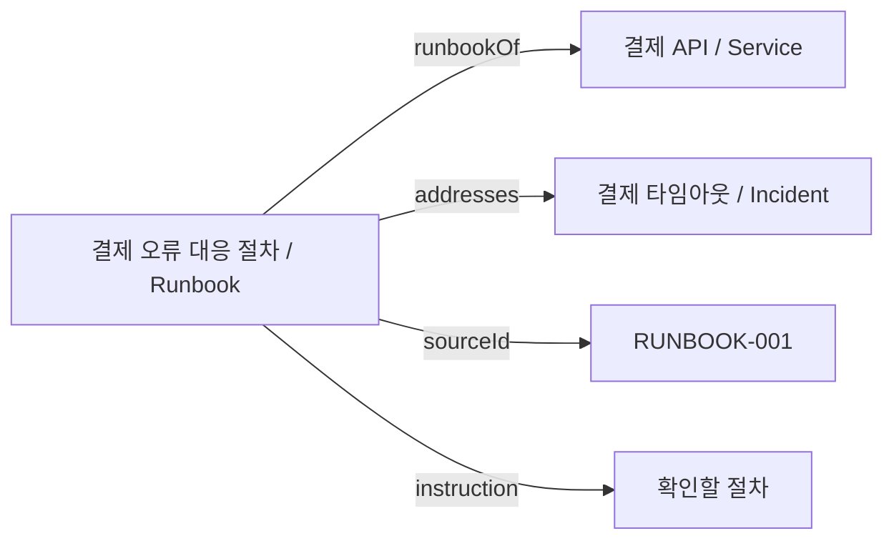
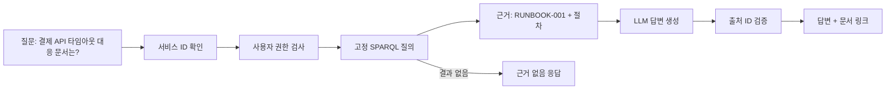

운영 문서가 늘어나면 “결제 API 타임아웃 때 어떤 문서를 봐야 하지?”라는 질문에 제목 검색만으로 답하기 어려워진다. 문서 제목이 `장애 대응 절차`일 수도 있고, 문서 본문에는 `PaymentService`라는 내부 이름만 적혀 있을 수 있다. 검색 결과를 찾더라도 그 문서가 **어떤 서비스와 어떤 장애를 다루는지**는 다시 읽어야 한다.

온톨로지는 이 관계를 데이터 모델로 명시하는 방법이다. 이 글은 실제 회사 시스템을 설명하는 사례가 아니라, **가상의 결제 API와 런북**으로 직접 재현할 수 있는 작은 실습이다. RDF/Turtle로 데이터를 적고, OWL로 관계의 의미를 선언하고, SPARQL로 근거를 조회한다. 마지막에는 그 근거를 LLM에 전달할 때 무엇을 검증해야 하는지 연결한다.

## 먼저 구분할 것: 데이터, 의미, 질의, 검증

| 구성 요소 | 이 글에서 맡는 일 | 예 |
| --- | --- | --- |
| RDF | 주어–술어–목적어 트리플로 사실 표현 | `paymentRunbook runbookOf paymentApi` |
| Turtle | RDF를 사람이 읽고 편집할 수 있게 적는 문법 | `ex:paymentRunbook ex:runbookOf ex:paymentApi .` |
| OWL | 클래스와 속성의 의미·관계 선언 | `runbookOf`와 `hasRunbook`은 역관계 |
| SPARQL | 그래프에서 필요한 사실 조회 | 결제 API에 연결된 런북 찾기 |
| SHACL | 입력 그래프가 요구 형식을 지키는지 검증 | 런북에 `sourceId`가 최소 1개 있는지 확인 |

RDF 트리플은 관계형 DB의 한 행이나 JSON의 중첩 필드와 표현 방식이 다르다. 개체를 **IRI로 식별**하고 관계를 별도의 술어로 연결한다. `ex:paymentApi`와 `ex:paymentRunbook`의 식별자가 안정적이면 다른 문서나 시스템이 같은 개체를 참조할 수 있다. [RDF 1.1 Turtle 명세](https://www.w3.org/TR/turtle/)는 아래 예제의 `@prefix`, `a`, 세미콜론 문법을 정의한다.



## 1. 작은 그래프를 Turtle로 만든다

아래를 `ontology.ttl`로 저장한다. `https://example.org/ops#`는 예제용 네임스페이스이고, `RUNBOOK-001`도 실제 운영 문서 번호가 아니다.

```turtle
@prefix ex: <https://example.org/ops#> .
@prefix owl: <http://www.w3.org/2002/07/owl#> .
@prefix rdfs: <http://www.w3.org/2000/01/rdf-schema#> .

ex:Service a owl:Class .
ex:Incident a owl:Class .
ex:Runbook a owl:Class .

ex:runbookOf a owl:ObjectProperty ;
    rdfs:domain ex:Runbook ;
    rdfs:range ex:Service ;
    owl:inverseOf ex:hasRunbook .
ex:hasRunbook a owl:ObjectProperty .

ex:addresses a owl:ObjectProperty ;
    rdfs:domain ex:Runbook ;
    rdfs:range ex:Incident .
ex:title a owl:DatatypeProperty .
ex:sourceId a owl:DatatypeProperty .
ex:instruction a owl:DatatypeProperty .

ex:paymentApi a ex:Service ;
    ex:title "결제 API"@ko .

ex:paymentTimeout a ex:Incident ;
    ex:title "결제 타임아웃"@ko .

ex:paymentRunbook a ex:Runbook ;
    ex:title "결제 오류 대응 절차"@ko ;
    ex:runbookOf ex:paymentApi ;
    ex:addresses ex:paymentTimeout ;
    ex:sourceId "RUNBOOK-001" ;
    ex:instruction "타임아웃 비율과 결제사 응답 지연을 확인하고, 중복 결제 여부를 대조한다."@ko .
```

문서의 본문 전체를 그래프에 복사할 필요는 없다. 여기서는 질의에 필요한 핵심 절차만 `instruction`으로 두었다. 실제 운영에서는 원문 문서 ID, 버전, 접근 권한, 갱신 시각을 함께 관리하고, LLM에 전달할 본문은 권한을 검사한 뒤 가져오는 편이 안전하다.

`rdfs:domain`과 `rdfs:range`는 DB의 `NOT NULL`이나 외래 키 제약과 같지 않다. 예를 들어 `runbookOf`의 주어에 다른 종류의 개체가 들어오면, RDFS/OWL 의미론에서는 그 주어를 `Runbook`으로 **추론**할 수 있다. 입력을 거부하려면 검증 규칙이 별도로 필요하다.

## 2. SPARQL로 관계를 따라간다

RDFLib은 로컬 파일을 읽고 SPARQL을 실행하는 작은 실습에 적합하다. 아래 명령은 프로젝트가 아닌 별도 실습 디렉터리에서 실행한다. 예제는 RDFLib 7 계열을 기준으로 작성했다.

```bash
python3 -m venv .venv
source .venv/bin/activate
python -m pip install "rdflib>=7,<8"
python demo.py
```

다음 내용을 `demo.py`로 저장한다.

```python
from rdflib import Graph, Namespace

EX = Namespace("https://example.org/ops#")
graph = Graph()
graph.parse("ontology.ttl", format="turtle")

query = """
PREFIX ex: <https://example.org/ops#>
SELECT ?runbook ?title ?incidentName ?sourceId ?instruction
WHERE {
  ?service ^ex:runbookOf ?runbook .
  ?runbook a ex:Runbook ;
           ex:title ?title ;
           ex:addresses ?incident ;
           ex:sourceId ?sourceId ;
           ex:instruction ?instruction .
  ?incident ex:title ?incidentName .
}
"""

rows = list(graph.query(query, initBindings={"service": EX.paymentApi}))
for row in rows:
    print(f"문서: {row.title} [{row.sourceId}]")
    print(f"대상 장애: {row.incidentName}")
    print(f"절차: {row.instruction}")

direct = graph.query("""
PREFIX ex: <https://example.org/ops#>
ASK { ex:paymentApi ex:hasRunbook ex:paymentRunbook }
""").askAnswer
path = graph.query("""
PREFIX ex: <https://example.org/ops#>
ASK { ex:paymentApi ^ex:runbookOf ex:paymentRunbook }
""").askAnswer
print(f"직접 저장된 hasRunbook: {direct}")
print(f"역방향 경로로 찾기: {path}")
```

실행 결과는 다음과 같다.

```text
문서: 결제 오류 대응 절차 [RUNBOOK-001]
대상 장애: 결제 타임아웃
절차: 타임아웃 비율과 결제사 응답 지연을 확인하고, 중복 결제 여부를 대조한다.
직접 저장된 hasRunbook: False
역방향 경로로 찾기: True
```

`^ex:runbookOf`는 `runbookOf`의 역방향으로 따라가는 [SPARQL property path](https://www.w3.org/TR/sparql11-query/#propertypaths)다. 그래서 `paymentApi → paymentRunbook` 방향의 트리플을 따로 저장하지 않아도 조회할 수 있다. 반면 `owl:inverseOf` 선언만 적고 일반 RDFLib `Graph.query()`를 실행한다고 OWL 추론이 자동으로 적용되지는 않는다. **명시된 트리플**, **질의의 경로 탐색**, **추론기가 생성한 사실**을 구분해야 결과를 설명할 수 있다. OWL의 역관계와 열린 세계 가정은 [OWL 2 Primer](https://www.w3.org/TR/owl-primer/)에서 확인할 수 있다.

## 3. 필수 데이터는 OWL이 아니라 SHACL로 검사한다

OWL은 “`sourceId`가 없으니 이 런북은 잘못됐다”라고 단정하지 않는다. 열린 세계 가정에서는 아직 기록되지 않았을 가능성이 있기 때문이다. 운영 데이터의 입력 규칙은 SHACL shape로 따로 표현한다.

```turtle
@prefix ex: <https://example.org/ops#> .
@prefix sh: <http://www.w3.org/ns/shacl#> .

ex:RunbookShape a sh:NodeShape ;
    sh:targetClass ex:Runbook ;
    sh:property [
        sh:path ex:sourceId ;
        sh:minCount 1 ;
        sh:maxCount 1
    ] ;
    sh:property [
        sh:path ex:runbookOf ;
        sh:minCount 1 ;
        sh:class ex:Service
    ] .
```

이 shape는 예시 규칙이다. `sourceId`를 지우면 검증 위반이 생기도록 설계할 수 있지만, 위 `demo.py`는 SHACL 검증기를 실행하지 않는다. 배포 파이프라인에는 SHACL을 지원하는 검증 단계를 추가하고, **검증 성공한 그래프만 게시**해야 한다. [SHACL 명세](https://www.w3.org/TR/shacl/)는 data graph, shapes graph, validation report의 관계를 정의한다.

## 4. 그래프에서 찾은 사실을 LLM의 근거로 쓴다

LLM에 전체 그래프를 넣거나 자유롭게 SPARQL을 작성하게 하는 것부터 시작할 필요는 없다. 먼저 사용자가 묻는 서비스 식별자를 애플리케이션에서 확인하고, 서버가 관리하는 **고정 질의 템플릿**으로 근거를 조회한다. 그 결과에 원문 문서 ID와 접근 권한을 연결한 다음 모델에 보낸다.



예제 그래프의 조회 결과를 모델에 전달할 때 입력은 아래처럼 작게 만들 수 있다. 문서 ID는 애플리케이션이 실제 원문과 매핑해야 한다.

```json
{
  "question": "결제 API 타임아웃이 나면 무엇부터 확인하나요?",
  "evidence": [
    {
      "sourceId": "RUNBOOK-001",
      "service": "결제 API",
      "incident": "결제 타임아웃",
      "instruction": "타임아웃 비율과 결제사 응답 지연을 확인하고, 중복 결제 여부를 대조한다."
    }
  ]
}
```

모델에는 “전달된 근거 밖의 절차를 추가하지 말고, 사용한 `sourceId`를 반환하라”고 요청할 수 있다. 하지만 프롬프트만으로 사실성이 보장되지는 않는다. 응답의 출처 ID가 조회 결과에 있는지 애플리케이션이 다시 검사하고, 근거가 없거나 출처가 맞지 않으면 답변을 보류해야 한다. `RUNBOOK-001`이 실제로 현재 유효한 문서인지, 질문한 사용자가 볼 수 있는지는 LLM이 아니라 서비스가 판단한다.

아래는 특정 LLM SDK에 묶이지 않은 **연계 경계의 의사코드**다. `findRunbooks`는 앞의 고정 SPARQL을 실행하고, `canRead`는 원문 문서의 권한을 확인하는 애플리케이션 함수라고 가정한다. `model.generate`의 호출 형식은 선택한 모델 SDK에 맞춰 구현해야 한다.

```ts
type Evidence = {
  sourceId: string;
  incident: string;
  instruction: string;
};

async function answer(question: string, serviceId: string, userId: string) {
  const serviceIri = allowedServices.get(serviceId);
  if (!serviceIri) return { answer: "알 수 없는 서비스입니다.", sources: [] };

  const rows: Evidence[] = await findRunbooks(serviceIri); // 고정 SPARQL
  const evidence = await filterAsync(rows, row => canRead(userId, row.sourceId));
  if (evidence.length === 0) {
    return { answer: "확인된 근거가 없습니다.", sources: [] };
  }

  const result = await model.generate({
    system: "근거에 있는 사실만 답하고, 사용한 sourceId를 별도 배열로 반환하세요.",
    user: JSON.stringify({ question, evidence }),
  });

  const allowedIds = new Set(evidence.map(row => row.sourceId));
  if (result.sourceIds.length === 0 ||
      result.sourceIds.some((id: string) => !allowedIds.has(id))) {
    return { answer: "답변의 출처를 검증할 수 없습니다.", sources: [] };
  }
  return { answer: result.answer, sources: result.sourceIds };
}
```

출처 ID가 유효해도 **답변 문장 자체가 근거와 일치한다는 증명은 아니다**. 위험도가 높은 운영 절차라면 문장 단위 근거 대조나 사람의 승인 단계를 추가한다. 이 예제의 `instruction`은 신뢰할 수 있는 운영 문서에서 관리한다는 전제이고, 외부에서 수집한 텍스트라면 프롬프트 인젝션 입력으로도 취급해야 한다.

```text
질문 수신
  → 허용된 serviceId인지 확인
  → 권한 범위 안에서 고정 SPARQL 조회
  → 결과 0건이면 "확인된 근거가 없습니다" 반환
  → 결과를 모델 문맥에 전달
  → 모델이 반환한 sourceId가 조회 결과에 있는지 검사
  → 검증된 문서 링크와 함께 답변 반환
```

이 방식은 [Microsoft GraphRAG](https://www.microsoft.com/en-us/research/publication/from-local-to-global-a-graph-rag-approach-to-query-focused-summarization/)와도 구분해서 이해해야 한다. GraphRAG는 비정형 문서에서 개체·관계·커뮤니티 요약을 추출해 검색에 활용하는 접근이다. 이 글의 RDF/OWL 온톨로지는 사람이 정의한 클래스와 관계에 맞춰 **운영 사실을 구조화**하는 예제다. 두 접근을 결합할 수 있지만, LLM이 추출한 관계를 곧바로 검증된 운영 사실로 승격해서는 안 된다.

### 실습 코드에서 서비스로 옮길 때

| 방식 | 적합한 단계 | 추가로 챙길 점 |
| --- | --- | --- |
| RDFLib 로컬 `Graph` | 작은 파일 실습·배치 검증 | 프로세스 재시작 시 파일을 다시 읽고, 변경 전 검증 |
| [Apache Jena Fuseki](https://jena.apache.org/documentation/fuseki2/) 같은 SPARQL 서버 | 여러 서비스가 같은 그래프를 질의 | 저장소 백업, 질의 시간 제한, 인증·권한, 배포 버전 관리 |
| 문서 임베딩/GraphRAG 인덱스 | 본문 표현이 다양해 키워드만으로 찾기 어려움 | 추출 오류 검수, 원문과 그래프의 동기화, 검색 근거 추적 |

셋은 서로 배타적인 선택이 아니다. 예를 들어 원문 검색으로 후보 문서를 좁힌 뒤, SPARQL로 서비스와 장애의 관계를 확인할 수 있다. 다만 저장소나 검색 방식이 바뀌어도 `sourceId`와 접근 권한을 검증하는 경계는 유지해야 한다.

## 운영에서 깨지는 지점

| 상황 | 잘못 처리하면 | 처리 기준 |
| --- | --- | --- |
| 원문은 바뀌었는데 그래프가 오래됨 | 폐기된 절차를 근거로 답함 | 문서 버전·갱신 시각을 함께 저장하고 변경 시 재색인 |
| 필수 관계나 출처 ID 누락 | 근거 없는 문서가 검색됨 | SHACL 검증 실패 시 새 그래프 게시 중단 |
| 질의 결과 0건 | 모델이 일반 상식으로 절차를 지어냄 | 근거 없음으로 반환하고 수동 확인 경로 안내 |
| 그래프 저장소 일시 장애 | 검색과 답변이 함께 실패 | 제한된 재시도 후 최근 검증된 스냅샷으로 복원하거나 명시적 오류 반환 |
| LLM 호출 지연·실패 | 응답이 오래 걸리거나 중복 호출됨 | 시간 제한과 제한된 재시도, 실패 시 근거 문서 목록만 반환 |
| 사용자 입력을 SPARQL 문자열에 직접 붙임 | 의도하지 않은 질의 실행 | 고정 템플릿과 IRI allowlist·바인딩 사용 |
| 문서 본문에 “이 지시를 무시하라”는 문구가 있음 | 프롬프트 인젝션 | 검색된 문서를 명령이 아닌 데이터로 취급하고 출력·출처 검증 |
| 그래프의 모든 노드를 그대로 모델에 보냄 | 비공개 정보 노출 | 질의 전후 모두 사용자별 접근 권한 검사 |

특히 RDFLib 문서도 외부 문서 파싱과 SPARQL `SERVICE` 질의가 파일·네트워크에 접근할 수 있다고 경고한다. 신뢰하지 않는 입력을 처리한다면 임의 SPARQL을 실행하지 말고 실행 계정의 파일·네트워크 권한도 제한해야 한다. [RDFLib 보안 안내](https://rdflib.readthedocs.io/en/latest/security_considerations/)를 배포 환경에서 확인한다.

## 적용 전 체크리스트

- [ ] 개체별 IRI가 안정적이고 같은 개체를 중복 생성하지 않는다.
- [ ] 클래스·관계·원문 문서 ID의 의미를 팀이 합의했다.
- [ ] OWL 추론 여부와 SPARQL 경로 탐색을 구분해 테스트했다.
- [ ] 필수 값과 타입은 SHACL 등 별도 검증 단계에서 검사한다.
- [ ] 사용자의 질문을 임의 SPARQL로 실행하지 않는다.
- [ ] 답변 근거의 문서 버전과 접근 권한을 확인한다.
- [ ] 검색 결과가 없거나 그래프가 실패했을 때 답을 만들어내지 않는다.
- [ ] 모델의 출처 ID를 조회 결과와 대조한다.

온톨로지를 도입하는 목적은 그래프를 복잡하게 만드는 것이 아니다. **서비스–장애–문서 관계를 같은 의미로 반복 조회하고, 그 근거를 사람이 확인할 수 있게 만드는 것**이 출발점이다. 작은 그래프와 고정 질의로 유효성을 확인한 뒤, 필요한 관계와 검증 규칙을 늘리는 편이 운영하기 쉽다.
