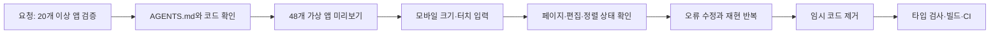

코딩 에이전트에게 “앱 런처를 확인해줘”라고만 지시하면 코드 몇 줄을 읽고 끝내기 쉽다. 이번에는 더 구체적인 요청이 있었다. `/apps`에 앱을 20개 이상 넣었을 때 페이지 넘김, 길게 누르기, 드래그, 화면 회전이 제대로 동작하는지 확인하고, 문제를 고치는 일이었다. 당시 공개 앱은 소수였으므로 현재 화면만 열어서는 다중 페이지 동작을 볼 수 없었다.

이 글은 **이 블로그 저장소에서 실제로 수행한 작업**을 하네스 관점에서 정리한 기록이다. 48개 가상 앱을 임시로 주입하고, 모바일 크기와 터치 입력을 재현하고, DOM 상태와 화면을 확인한 뒤, 발견한 오류를 수정했다. 검증 후 가상 앱 경로와 자동화 스크립트는 제거했고, 런처 수정만 [커밋 `0fbfde7`](https://github.com/hae02y/hae02y-blog/commit/0fbfde7)에 남겼다. **물리 iPhone에서 직접 검증한 사례는 아니다.** 사용한 브라우저는 Chrome의 모바일 에뮬레이션이었다.

## 여기서 하네스가 맡은 일

하네스는 모델을 대신해 코드를 작성하는 도구가 아니다. 작업의 입력, 실행 환경, 관찰 방법, 완료 조건을 묶는 장치다. 이 사례에서는 저장소의 `AGENTS.md`, 임시 미리보기, 터치 입력 자동화, `yarn typecheck`와 `yarn build`, GitHub Actions가 각각 한 부분을 맡았다.



이 연결이 없었다면 2개 앱이 정상적으로 보인다는 사실만으로 “페이지 이동도 괜찮다”고 추측했을 수 있다. 하네스의 핵심은 **검증할 수 있는 입력을 만들고, 관찰한 결과를 코드 변경과 연결하는 것**이었다.

| 경계 | 이 작업의 실제 구성 | 확인할 질문 |
| --- | --- | --- |
| 작업 규칙 | `AGENTS.md` | 어떤 파일을 수정하고 어떤 명령을 실행할까? |
| 입력 데이터 | 임시 경로의 48개 가상 앱 | 한 화면을 넘는 앱 수가 있는가? |
| 실행 환경 | 로컬 Next.js 개발 서버와 Chrome | 모바일 화면 크기와 터치 이벤트가 적용됐는가? |
| 관찰 | 페이지 번호, 편집 상태, `localStorage`, 스크린샷 | 손동작 뒤 상태가 실제로 달라졌는가? |
| 게이트 | 타입 검사, 빌드, GitHub Actions | 수정이 다른 코드와 함께 통과하는가? |

## 1. 실제 앱 데이터와 검증 데이터를 분리했다

공개 앱은 DB의 `apps` 테이블에서 읽고 `/apps`에 표시한다. 검증을 위해 DB에 가짜 앱 48개를 넣으면 나중에 지워야 하고, 공개 목록에 섞일 위험도 생긴다. 대신 개발 중에만 쓰는 임시 경로에서 `PhoneLauncher`에 배열을 직접 전달했다. 검증이 끝난 뒤 이 파일은 삭제했다.

아래는 당시 입력 데이터의 핵심 형태를 줄인 예시다.

```tsx
const previewApps = Array.from({ length: 48 }, (_, index) => ({
  id: 1000 + index,
  name: `테스트 앱 ${index + 1}`,
  shortName: `앱 ${index + 1}`,
  description: `테스트용 앱 ${index + 1}`,
  href: `https://example.com/${index + 1}`,
  category: '미리보기',
  icon: ['app', 'game', 'flask', 'globe', 'dice', 'phone'][index % 6],
  iconImage: null,
}));

export default function PreviewPage() {
  return <PhoneLauncher apps={previewApps} />;
}
```

여기서 48이라는 값은 제품 요구사항이 아니다. 세로 화면에서 한 페이지에 24개, 가로로 펼쳤을 때 한 번에 24개가 보이는 조건에서 **두 번째 페이지를 반드시 만들기 위한 검증 입력**이었다. 아이콘 종류를 순환시킨 것도 각 항목의 이동을 눈으로 구분하기 위해서다.

## 2. 화면 크기와 입력 이벤트를 고정했다

검증 스크립트는 로컬 개발 서버의 임시 경로를 열고 Chrome DevTools Protocol로 화면 크기와 터치 입력을 설정했다. 세로는 `390 × 844`, 가로는 `844 × 390` CSS 픽셀로 확인했다. [CDP의 `Emulation` 도메인](https://chromedevtools.github.io/devtools-protocol/tot/Emulation/)은 화면 크기를, [`Input.dispatchTouchEvent`](https://chromedevtools.github.io/devtools-protocol/tot/Input/#method-dispatchTouchEvent)는 터치 시작·이동·종료를 전달한다.

```python
# 당시 일회성 스크립트에서 사용한 호출의 핵심 형태
call('Emulation.setDeviceMetricsOverride', {
    'width': 390,
    'height': 844,
    'deviceScaleFactor': 3,
    'mobile': True,
    'screenOrientation': {'type': 'portraitPrimary', 'angle': 0},
})
call('Emulation.setTouchEmulationEnabled', {
    'enabled': True,
    'maxTouchPoints': 1,
})
call('Input.dispatchTouchEvent', {
    'type': 'touchStart',
    'touchPoints': [{'x': 61, 'y': 127, 'id': 1}],
})
```

위 코드는 독립 실행 파일 전체가 아니라 재현에 필요한 프로토콜 호출만 추린 것이다. `call()`은 CDP WebSocket에 메시지를 보내고 같은 요청 ID의 응답을 기다리는 헬퍼였다. 자동화는 DOM에서 보이는 아이콘의 좌표를 구해 터치했기 때문에, CSS가 바뀌어도 고정 좌표에만 의존하지 않았다. 이 방식은 브라우저 엔진의 터치 처리를 확인하는 데 유용하지만, iOS Safari나 실제 기기의 성능·안전 영역을 대신 검증하지는 않는다.

## 3. 결과를 상태 전이로 확인했다

화면이 “그럴듯하게” 보이는지만 확인하면 길게 누른 뒤 손가락을 움직일 때 무슨 일이 일어났는지 놓친다. 그래서 각 제스처 뒤 현재 페이지, 편집 모드, 드래그 대상, `localStorage`의 앱 ID 순서를 읽었다.

| 입력 | 기대 상태 | 관찰한 결과 |
| --- | --- | --- |
| 세로 화면에서 왼쪽으로 밀기 | 1페이지 → 2페이지 | ID `1024`부터 표시 |
| 오른쪽으로 밀기 | 2페이지 → 1페이지 | ID `1000`부터 표시 |
| 아이콘을 약 520ms 누르기 | 편집 모드 진입 | 편집 상태로 전환 |
| 누른 손가락을 다른 아이콘으로 이동 | 드래그 대상 표시, 놓으면 정렬 | 처음에는 실패, 수정 후 성공 |
| 가로로 회전 | 두 화면 펼침 | 12개씩 양쪽에 표시 |
| 다시 세로로 회전 | 한 화면으로 접힘 | 정렬 상태를 유지하며 복귀 |

처음에는 길게 누르면 편집 모드에 들어갔지만, 같은 손동작으로 드래그가 이어지지 않았다. 별도로 손가락을 다시 대야 하는 것처럼 보였고, 실제 이동은 취소됐다. 브라우저가 터치를 스크롤로 처리하기 시작하면 `pointercancel`로 Pointer 이벤트 흐름을 중단할 수 있다는 점을 원인 후보로 좁혔다. [MDN의 `touch-action` 설명](https://developer.mozilla.org/en-US/docs/Web/CSS/Reference/Properties/touch-action)에 따르면 **제스처가 시작된 뒤 `touch-action`을 바꿔도 그 제스처에는 적용되지 않는다.** 편집 모드 진입 후에만 `touch-action: none`을 주는 방식으로는 늦었다.

수정은 세 부분이었다.

```css
.appTile {
  touch-action: none;
}
```

```tsx
function startAppPointer(event: React.PointerEvent<HTMLAnchorElement>, id: number) {
  event.currentTarget.setPointerCapture(event.pointerId);
  holdTimer.current = setTimeout(() => {
    setIsEditing(true);
    dragIdRef.current = id;
    setDraggedId(id);
  }, 520);
}
```

```tsx
function endAppPointer(cancelled = false) {
  if (!cancelled && dragIdRef.current !== null && dropIdRef.current !== null) {
    moveApp(dragIdRef.current, dropIdRef.current);
  }
  // 타이머·드래그 참조·표시 상태 정리
}
```

아이콘 터치의 시작점에서 브라우저 기본 제스처를 막고 포인터를 잡아 두었다. 길게 누르기 타이머가 끝나면 같은 포인터를 드래그 상태로 이어 갔다. 이동 중에는 `document.elementsFromPoint()`로 포인터 아래의 다른 아이콘을 찾고, 놓을 때 순서를 바꿨다. `pointercancel`에서는 정렬을 저장하지 않도록 분기했다. 사용자가 손가락을 놓지 않았는데 화면 회전이나 브라우저 동작으로 입력이 취소될 수도 있기 때문이다.

검증 후에는 같은 행과 다른 행의 아이콘으로 모두 이동했고, ID 순서가 `localStorage`에 저장되는 것을 확인했다. 세로로 접힌 화면의 중앙에 힌지 선이 남아 있던 시각 오류도 스크린샷으로 찾아 수정했다. **페이지를 가로질러 아이콘을 끄는 자동 넘김은 이 작업에서 구현하거나 검증하지 않았다.**

## 실패, 복구, 보안 경계

하네스를 만들 때 성공 경로만 적으면 다음 작업에서 같은 실패를 반복한다. 이번 사례의 경계는 다음과 같았다.

1. **입력 분리**: 가상 앱은 DB에 넣지 않고 임시 경로에서만 전달했다. 검증 후 경로와 스크립트를 삭제하고 변경 파일을 다시 확인했다.
2. **이벤트 취소**: `pointerup`은 정렬 확정, `pointercancel`은 정렬 취소로 처리했다. 두 이벤트를 같은 성공 경로로 묶지 않았다.
3. **상태 복원**: 사용자 정렬은 브라우저 `localStorage`에 저장된다. 앱 목록이 바뀌면 저장된 ID 중 현재 존재하는 것만 유지하고 신규 앱 ID를 뒤에 붙인다. 저장소를 읽지 못할 때는 기본 게시 순서를 사용한다.
4. **권한 분리**: 로컬 미리보기에는 가상 URL만 사용하고 DB 연결 값은 출력하지 않았다. CDP 디버깅 포트는 로컬 검증용으로만 열고 검증 후 브라우저와 개발 서버를 종료했다.
5. **배포 게이트**: `yarn typecheck`, `yarn build`, `git diff --check`를 통과한 뒤 관련 파일만 커밋했다. `main` 푸시 후 GitHub Actions의 타입 검사 성공까지 확인했다. 이 저장소의 실제 배포는 Vercel이 Git 푸시로 수행하며, GitHub Actions는 타입 검사만 맡는다.

빌드 명령에는 DB가 있을 때 글과 앱을 시드하는 단계도 있다. 로컬에서 `DATABASE_URL`이 없으면 해당 단계는 건너뛰고 빌드를 계속한다. 따라서 **로컬 빌드 성공만으로 운영 DB의 게시 성공을 증명할 수는 없다.** 콘텐츠를 발행할 때는 배포 뒤 실제 URL과 DB 반영을 별도로 확인해야 한다.

## 다른 저장소에 적용할 때의 체크리스트

- [ ] 작업 규칙에 수정 범위, 실행 명령, 배포 조건을 적었는가?
- [ ] 현재 데이터로 재현되지 않는 조건을 별도 fixture로 만들었는가?
- [ ] fixture가 운영 DB나 공개 화면에 섞이지 않는가?
- [ ] 입력 전후의 상태를 페이지·DOM·저장소 값으로 확인했는가?
- [ ] `pointercancel`, 타임아웃, 화면 회전처럼 성공 외의 상태 전이를 확인했는가?
- [ ] 임시 도구를 지우고 관련 파일만 커밋했는가?
- [ ] 로컬 검사, CI, 실제 배포 확인의 범위를 구분했는가?

이번에 구축한 것은 영구적인 테스트 플랫폼이 아니라 **한 작업을 끝까지 검증하기 위한 일회성 하네스**였다. 장점은 실제 오류를 재현하고 수정 근거를 남겼다는 점이다. 한계는 Chrome 에뮬레이션만으로 iOS Safari 실기기 동작을 확정할 수 없고, 임시 스크립트를 삭제했으므로 동일 시나리오가 CI에서 자동으로 반복되지는 않는다는 점이다. 이후 앱이 늘어날 때 이 시나리오를 반복해서 확인할 필요가 생기면, 그때 fixture와 브라우저 검증을 지속 가능한 테스트로 옮길 수 있다.

## 참고 자료

- [Chrome DevTools Protocol: Input](https://chromedevtools.github.io/devtools-protocol/tot/Input/)
- [Chrome DevTools Protocol: Emulation](https://chromedevtools.github.io/devtools-protocol/tot/Emulation/)
- [MDN: `touch-action`](https://developer.mozilla.org/en-US/docs/Web/CSS/Reference/Properties/touch-action)
- [MDN: `pointercancel`](https://developer.mozilla.org/en-US/docs/Web/API/Element/pointercancel_event)
- [GitHub Docs: Triggering a workflow](https://docs.github.com/en/actions/how-tos/write-workflows/choose-when-workflows-run/trigger-a-workflow)
- [Vercel Docs: Deploying Git repositories](https://vercel.com/docs/git)
