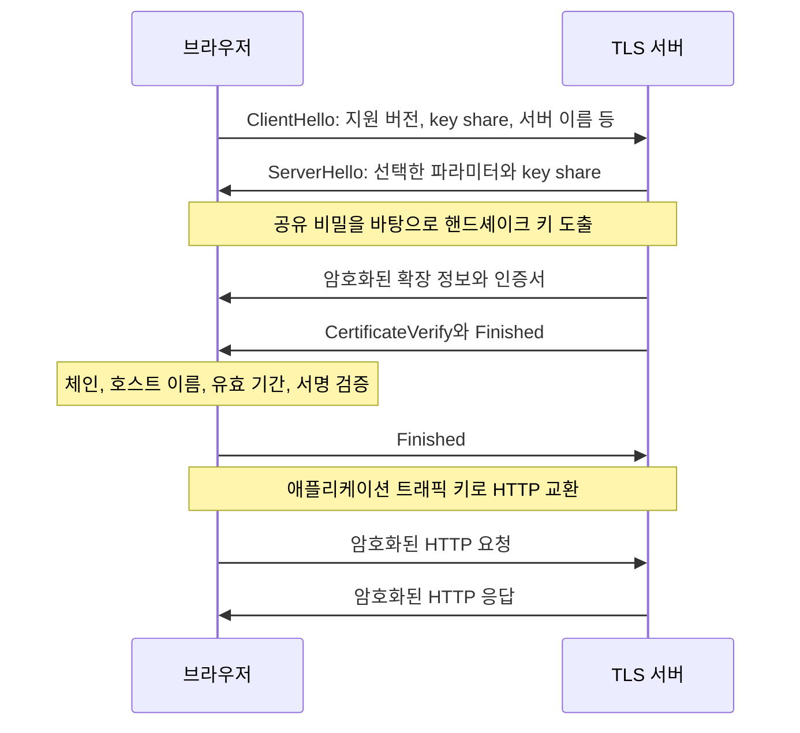

도메인을 연결하고 브라우저에 주소를 넣었는데 인증서 오류가 뜬다. DNS 조회는 정상이다. 서버도 살아 있다. 그렇다면 무엇이 잘못된 걸까?

DNS가 답한 질문은 “이 이름으로 어디에 연결할까?”다. HTTPS가 이어서 확인할 질문은 “연결한 상대가 이 이름의 서버라는 것을 어떻게 믿을까?”다. 주소를 찾는 것과 상대를 검증하는 것은 다른 작업이다.

이 글은 [DNS·도메인·레코드와 권한 DNS 직접 구축 글](/blog/dns-domain-records-authoritative-server/)의 다음 편이다. 앞 글에서 이름을 IP로 찾았다면, 여기서는 그 IP에 연결한 뒤 인증하고 암호화하는 과정을 따라간다. **이하 Nginx와 인증서 발급 예제는 재현용 구성이지, 이 블로그의 실제 운영 서버 설정을 공개한 기록이 아니다.** `example.com`은 설명용 예약 도메인이므로 실제 인증서 발급 실습에서는 소유한 도메인으로 바꿔야 한다.

## 1. SSL, TLS, HTTPS는 각각 무엇인가

관리 화면에는 아직 “SSL 인증서”, “SSL 설정”이라는 표현이 흔하다. 그러나 현대적인 HTTPS 연결에서 사용하는 프로토콜은 TLS다. SSL은 이전 세대의 이름이고, 인증서를 설치하는 메뉴에 그 표현이 남아 있는 것이다.

HTTPS는 HTTP 메시지를 TLS로 보호해서 전달하는 방식이다. 일반적인 HTTP/1.1·HTTP/2 연결은 TCP 위에서 TLS를 사용한다. HTTP/3은 QUIC에 TLS 1.3의 핸드셰이크를 통합하므로 전송 구조가 다르다. 이 글의 실습은 이해하기 쉬운 TCP 443의 HTTPS를 기준으로 한다.

| 구성 요소 | 역할 | 이것만으로 해결되지 않는 것 |
| --- | --- | --- |
| DNS | 접속할 이름의 주소·관련 정보를 조회 | 서버가 그 이름의 정당한 상대인지 검증 |
| TCP/QUIC | 네트워크 연결과 데이터 전달 | 웹 서비스의 사용자 권한 |
| TLS | 상대 인증, 연결의 기밀성·무결성 | SQL injection, XSS, 잘못된 권한 검사 |
| HTTP | 경로·헤더·상태 코드·본문을 교환 | 전송 구간의 보호 자체 |
| 애플리케이션 인증 | 로그인과 사용자 식별 | 웹 서버 인증서의 유효성 |

정상적인 인증서 검증을 전제로, 네트워크 중간에서 연결 내용을 읽거나 바꾸는 위험을 TLS가 줄여 준다. 반대로 HTTPS 사이트가 악성 콘텐츠를 제공하는 것까지 막아 주지는 않는다. 자물쇠 표시는 콘텐츠의 선량함을 보증하는 배지가 아니다.

TLS 1.3의 현재 규격은 2026년 7월 발행된 [RFC 9846](https://datatracker.ietf.org/doc/html/rfc9846)이다. 이전 자료에 많이 인용되는 RFC 8446을 대체한다. HTTP/3의 구조는 [RFC 9114](https://datatracker.ietf.org/doc/html/rfc9114)에 따로 정의되어 있다.

## 2. 인증서는 비밀번호가 아니라, 이름과 공개키를 묶은 문서다

서버 인증서는 대략 다음 정보를 담는다.

```text
인증서
├─ Subject Alternative Name: example.com, www.example.com
├─ 공개키: 서버가 사용하는 키 쌍의 공개 부분
├─ 발급자: 이 인증서에 서명한 CA
├─ 유효 기간: notBefore ~ notAfter
├─ 용도와 제약: 서버 인증용인지, CA 인증서인지 등
└─ 발급자의 전자서명
```

인증서는 공개되어도 된다. 브라우저에 전달해야 하는 정보이기 때문이다. **개인키는 인증서 안에 없으며, 외부에 공개해서는 안 된다.** 개인키를 가진 상대만 수행할 수 있는 서명을 확인하는 과정이 있어야 인증서를 복사한 공격자와 실제 서버를 구별할 수 있다.

CA는 Certificate Authority, 인증기관이다. 보통 최종 서버 인증서 위에 중간 CA가 있고, 그 위에 신뢰 기준이 되는 루트가 있다.

```text
클라이언트가 이미 신뢰하는 루트 CA
  └─ 중간 CA 인증서
       └─ example.com 서버 인증서
```

서버가 “이 루트를 믿으세요”라고 보내는 것만으로 신뢰가 만들어지지 않는다. 클라이언트의 신뢰 저장소에 이미 들어 있는 신뢰 기준까지 검증 경로가 연결되어야 한다. 브라우저, 운영체제, 컨테이너, 런타임이 사용하는 신뢰 저장소는 다를 수 있다. 그래서 브라우저에서는 되는데 오래된 컨테이너의 클라이언트에서는 실패할 수 있다. 인증서 구조와 검증 경로의 기초는 [X.509 인증서 프로파일](https://datatracker.ietf.org/doc/html/rfc5280)에 정의되어 있다.

### 이름 확인은 IP 확인과 다르다

`https://example.com`에 접속했다면 인증서의 SAN에 `example.com`을 만족하는 이름이 있어야 한다. 같은 IP에서 서비스하는 `other.example` 인증서가 있어도 대체할 수 없다. IP 주소로 직접 접속할 경우에는 그 IP를 위한 적절한 인증서 식별자가 필요하다.

와일드카드도 무제한 매칭은 아니다.

| 인증서 SAN | `example.com` | `www.example.com` | `a.b.example.com` |
| --- | --- | --- | --- |
| `example.com` | 가능 | 불가 | 불가 |
| `*.example.com` | 불가 | 가능 | 불가 |
| `example.com`, `*.example.com` | 가능 | 가능 | 불가 |

현대적인 서비스 이름 검증은 SAN을 기준으로 이해해야 한다. 옛 예제의 Common Name만 설정하는 방식을 그대로 복제하지 않는다. 와일드카드와 이름 매칭 규칙은 [RFC 9525](https://datatracker.ietf.org/doc/html/rfc9525)에 설명되어 있다.

## 3. TLS 1.3에서 실제로 오가는 것

다음은 인증서 기반의 새 연결에서 임시 ECDHE 키 교환을 사용하는 대표 흐름을 단순화한 것이다. 재연결의 PSK나 0-RTT, 클라이언트 인증 요청 등은 생략했다.



여기서 세 가지를 구분해야 한다.

- **키 합의:** ECDHE의 임시 키 재료로 양쪽이 공유 비밀을 얻는다.
- **서버 인증:** 인증서의 공개키로 검증할 수 있는 서명이 서버의 개인키 소유를 증명한다.
- **본문 암호화:** 도출한 대칭 트래픽 키로 실제 데이터를 보호한다.

“인증서의 공개키로 HTTP 본문을 전부 암호화한다”는 설명은 이 흐름을 잘못 이해하게 만든다. 인증서 서명용 키와 연결마다 도출하는 트래픽 키는 역할이 다르다. 임시 키 교환을 적절하게 사용하면 장기 개인키가 나중에 유출되더라도 과거 연결을 녹음한 데이터가 곧바로 복호화되는 것을 방지할 수 있다. 단, 현재 서버 장악이나 세션 키 자체의 유출까지 해결한다는 뜻은 아니다. [TLS 1.3 핸드셰이크와 키 스케줄](https://datatracker.ietf.org/doc/html/rfc9846#section-2)을 함께 보면 메시지들의 역할이 연결된다.

SNI는 여러 사이트를 제공하는 서버가 TLS 협상 단계에서 알맞은 인증서를 고를 때 사용하는 서버 이름 정보다. HTTP의 `Host` 헤더는 그 뒤의 HTTP 계층이다. 따라서 HTTPS 주소를 IP로 바꾼 뒤 `Host` 헤더만 수동으로 추가하는 것은 원래 도메인으로 접속하는 실험과 같지 않다. 이 차이는 뒤의 `curl --resolve` 실습에서 확인한다.

## 4. 인증서는 누가, 무엇을 확인하고 발급하는가

자동 발급에서 많이 사용하는 ACME는 클라이언트와 CA가 도메인 통제권 확인, 발급, 갱신을 수행하는 프로토콜이다. CA가 서버의 소스 코드나 비즈니스 신뢰도를 심사해서 HTTPS를 승인하는 방식이 아니다.

| 검증 방식 | 통제권을 증명하는 위치 | 적합한 경우 | 자주 실패하는 이유 |
| --- | --- | --- | --- |
| HTTP-01 | `http://도메인/.well-known/acme-challenge/...` | 공개 웹 서버의 일반 도메인 | 80 포트 차단, 잘못된 A/AAAA, 인증 필터, 다른 서버로 라우팅 |
| DNS-01 | `_acme-challenge.도메인`의 TXT | 와일드카드, 웹 서버와 분리한 발급 | 잘못된 DNS 계정, TTL·전파 대기, API 권한 누락 |

Let's Encrypt의 HTTP-01 검증은 80 포트로 시작하며 와일드카드 발급을 지원하지 않는다. DNS-01은 와일드카드를 지원하고 웹 서버를 직접 노출하지 않아도 되지만, CA가 조회하는 공개 DNS에 올바른 TXT가 보여야 한다. 서버 내부의 `/etc/hosts`만 바꿔서는 이 검증을 통과할 수 없다. [Let's Encrypt 검증 방식 문서](https://letsencrypt.org/docs/challenge-types/)를 기준으로 환경에 맞게 선택한다.

DNS-01 자동화를 위해 광범위한 DNS 계정 키를 웹 서버에 넣으면 침해 범위가 커진다. 가능하면 해당 존을 수정하는 데 필요한 최소 권한 토큰을 사용한다. 검증용 하위 이름을 별도의 존으로 위임하는 설계도 고려할 수 있다. 도메인 소유권 확인과 공개 DNS의 위임은 [DNS 구축 편](/blog/dns-domain-records-authoritative-server/)과 바로 이어지는 부분이다.

## 5. Nginx에 HTTPS를 직접 붙여 보기

실습 목표는 다음 하나다.

```text
외부 클라이언트 → example.com의 공인 IP → Nginx → 정적 응답
```

운영 중인 서버의 설정을 통째로 바꾸지 않도록 **별도 실습 VM과 소유한 테스트 도메인**을 사용한다. 아래는 Debian/Ubuntu 계열의 Nginx 패키지 디렉터리 구성을 가정한다. Nginx와 Certbot은 해당 배포판 및 [Certbot 공식 설치 안내](https://certbot.eff.org/instructions)에 맞춰 설치되어 있어야 한다. 다른 설치 방식에서는 포함되는 설정 경로와 서비스 관리 명령부터 확인한다.

실행 전 다음 조건을 갖춘다.

- 예제의 `example.com`, `www.example.com`, `admin@example.com`을 자신이 관리하는 값으로 교체한다.
- 두 이름의 A가 실습 서버의 IPv4를 가리켜야 한다. AAAA가 있다면 그 IPv6에서도 서비스되어야 한다. 사용하지 않는 잘못된 AAAA를 남겨두지 않는다.
- 서버 방화벽과 클라우드 보안 그룹에서 TCP 80·443의 필요한 외부 접근을 허용한다.
- 이 실습에서는 CDN 프록시를 끄고 DNS-only로 원본 서버에 직접 연결한다.
- 같은 `server_name`을 처리하는 기존 Nginx 설정이 없는지 확인한다.

### 5-1. 인증서가 없는 동안에는 HTTP 설정부터 올린다

인증서 파일도 없는데 443 설정부터 넣으면 Nginx가 파일을 읽지 못해 설정 검증에 실패한다. 처음에는 검증 경로를 제공하는 80 포트만 구성한다.

```bash
sudo install -d -m 755 /var/www/acme/.well-known/acme-challenge
sudo install -d -m 755 /var/www/tls-demo
printf '%s\n' 'HTTPS demo ready' | sudo tee /var/www/tls-demo/index.html
```

`/etc/nginx/sites-available/tls-demo` 파일을 다음 내용으로 만든다.

```nginx
server {
    listen 80;
    server_name example.com www.example.com;

    location ^~ /.well-known/acme-challenge/ {
        root /var/www/acme;
        default_type text/plain;
        try_files $uri =404;
    }

    location / {
        root /var/www/tls-demo;
        index index.html;
    }
}
```

IPv6 AAAA를 운영한다면 여기에 `listen [::]:80;`도 추가하고 외부 IPv6 경로를 확인한다. 아래 링크 생성은 같은 이름의 링크가 아직 없는 최초 설정 기준이다.

```bash
sudo ln -s /etc/nginx/sites-available/tls-demo /etc/nginx/sites-enabled/tls-demo
sudo nginx -t
sudo systemctl reload nginx
printf '%s\n' 'challenge path works' | sudo tee /var/www/acme/.well-known/acme-challenge/probe
curl --fail http://example.com/.well-known/acme-challenge/probe
curl --fail http://www.example.com/.well-known/acme-challenge/probe
```

두 URL에서 `challenge path works`가 나와야 한다. **서버 자체에서만 성공하는지 보지 말고 다른 네트워크에서도 확인한다.** 같은 내부망에서만 접근 가능한 경로는 공개 CA의 검증 경로가 아니다.

### 5-2. 검증 경로가 확인된 후 인증서를 발급한다

```bash
sudo certbot certonly --webroot -w /var/www/acme \
  --cert-name tls-demo \
  -d example.com -d www.example.com \
  --email admin@example.com
```

계정과 약관 관련 안내를 읽고 진행한다. `--cert-name tls-demo`를 지정했으므로 이후 파일 경로는 `/etc/letsencrypt/live/tls-demo/`를 사용한다. Certbot은 서버 설정과 별개로 인증서 파일을 만들며, `certonly --webroot`는 Nginx의 HTTPS 설정을 대신 작성하는 명령이 아니다.

처음 발급 흐름을 반복 실험할 때는 위 명령에 `--dry-run`을 붙여 staging 환경에서 먼저 확인할 수 있다. 이 모드는 시험 인증서를 디스크에 저장하지 않으므로, 검증 성공 후 `--dry-run` 없이 실행해야 다음 단계에 필요한 운영 인증서 파일이 생긴다. `--staging`으로 직접 저장한 인증서는 브라우저가 공개적으로 신뢰하는 운영 인증서가 아니므로 운영 파일과 섞지 않는다. 실패한 상태에서 명령을 계속 재실행하면 발급 제한에 걸릴 수 있다. [Staging 안내](https://letsencrypt.org/docs/staging-environment/)와 [발급 제한 안내](https://letsencrypt.org/docs/rate-limits/)를 확인하고, 실패 원인을 먼저 고친다.

### 5-3. 발급 후 443 설정을 추가한다

같은 설정 파일을 아래 구성으로 바꾼다. 앞서 준비한 인증서 경로가 실제로 존재해야 한다.

```nginx
server {
    listen 80;
    server_name example.com www.example.com;

    location ^~ /.well-known/acme-challenge/ {
        root /var/www/acme;
        default_type text/plain;
        try_files $uri =404;
    }

    location / {
        return 301 https://$host$request_uri;
    }
}

server {
    listen 443 ssl;
    server_name example.com www.example.com;

    ssl_certificate /etc/letsencrypt/live/tls-demo/fullchain.pem;
    ssl_certificate_key /etc/letsencrypt/live/tls-demo/privkey.pem;
    ssl_protocols TLSv1.2 TLSv1.3;

    root /var/www/tls-demo;
    index index.html;
}
```

IPv6를 사용한다면 두 블록에 각각 `listen [::]:80;`, `listen [::]:443 ssl;`을 추가한다. HTTP/2 활성화 문법은 설치한 Nginx 버전에 맞게 별도로 확인한다. 이 예제는 HTTP/2를 필수 조건으로 삼지 않는다.

```bash
sudo nginx -t
sudo systemctl reload nginx
curl --fail https://example.com/
curl --fail https://www.example.com/
```

이제 각 설정을 문장으로 읽을 수 있어야 한다.

| 설정 | 실제로 의미하는 것 |
| --- | --- |
| `listen 443 ssl` | 이 리스너가 TLS 연결을 받음 |
| `server_name` | 이 가상 서버에서 처리할 이름 |
| `ssl_certificate` | 클라이언트에 전달할 서버 인증서와 중간 인증서 체인 |
| `ssl_certificate_key` | 서버의 개인키 파일 |
| `ssl_protocols` | 허용할 TLS 버전 |
| ACME 경로의 `root` | 검증 토큰 파일을 읽을 디렉터리 |
| 80 포트의 `return 301` | 검증 경로 이외의 HTTP 요청을 HTTPS로 안내 |

Nginx는 서버 인증서 뒤에 중간 인증서를 붙인 체인 파일을 사용할 수 있다. 서버 인증서만 넣으면 일부 클라이언트에서 체인을 완성하지 못할 수 있다. 공개 루트 인증서를 무조건 덧붙이는 것과는 다르다. [Nginx HTTPS 설정과 체인 설명](https://nginx.org/en/docs/http/configuring_https_servers.html)을 참고한다.

### 5-4. 실제 애플리케이션을 연결한다면

위 예제는 정적 파일이므로 Node.js나 Python 프로세스는 없다. 앱을 붙일 때는 443 블록의 정적 응답을 다음처럼 바꿀 수 있다. 예제 앱이 `127.0.0.1:3000`에서 실행 중이라는 추가 전제다.

```nginx
location / {
    proxy_pass http://127.0.0.1:3000;
    proxy_set_header Host $host;
    proxy_set_header X-Forwarded-Proto $scheme;
    proxy_set_header X-Forwarded-For $proxy_add_x_forwarded_for;
}
```

이때 TLS는 Nginx에서 끝난다. 뒤의 앱까지 자동으로 TLS 연결이 이어지는 것이 아니다. 같은 호스트의 루프백인지, 다른 호스트로 나가는 네트워크인지에 따라 원본 구간 보호를 따로 설계해야 한다. 앱도 아무 인터넷 클라이언트가 보낸 전달 헤더를 신뢰하면 안 된다. 실제로 신뢰하는 프록시 뒤에서만 `X-Forwarded-*`를 해석하도록 설정한다. 프록시 지시어의 동작은 [Nginx proxy 모듈](https://nginx.org/en/docs/http/ngx_http_proxy_module.html)에 설명되어 있다.

## 6. 발급 성공보다 갱신 성공이 더 중요하다

인증서는 유효 기간이 있는 운영 자원이다. “한 번 발급했다”는 상태와 “갱신된 인증서를 실제 트래픽에 제공한다”는 상태 사이에는 여러 단계가 있다.

```text
갱신 시점 도달
→ 도메인 통제권 재검증
→ 새 인증서 파일 저장
→ Nginx가 새 파일을 읽도록 reload
→ 외부 접속에서 새 만료일 확인
```

파일이 바뀌어도 프로세스가 이전 인증서를 계속 들고 있으면 사용자는 만료된 인증서를 볼 수 있다. 갱신 성공 후 실행하는 deploy hook에 설정 검사와 reload를 연결한다.

```bash
sudo install -d -m 755 /etc/letsencrypt/renewal-hooks/deploy
sudo tee /etc/letsencrypt/renewal-hooks/deploy/reload-nginx >/dev/null <<'SH'
#!/bin/sh
set -eu
nginx -t
systemctl reload nginx
SH
sudo chmod 755 /etc/letsencrypt/renewal-hooks/deploy/reload-nginx
sudo certbot renew --dry-run
```

deploy hook은 기본 dry-run에서 실행되지 않는다. 설치한 Certbot에서 지원한다면 `sudo certbot renew --cert-name tls-demo --dry-run --run-deploy-hooks`로 hook 동작까지 확인한다. 이때 hook은 시험 인증서가 아니라 현재 활성 인증서를 사용하므로, 실제 새 인증서 배치 후에는 외부 만료일 확인도 필요하다. 자동 실행은 설치 방식에 따라 systemd timer나 cron 등이 담당하므로 **현재 설치에 갱신 스케줄이 실제로 존재하는지** 확인한다. 이미 있는 스케줄에 중복 작업을 추가하지 않는다. [Certbot 갱신·hook 문서](https://eff-certbot.readthedocs.io/en/stable/using.html#renewing-certificates)가 기준이다.

갱신 장애 때는 다음 순서로 접근한다.

1. 기존 인증서의 만료일과 실제로 서비스되는 인증서의 만료일을 비교한다.
2. HTTP-01이면 검증 URL과 80 포트, A/AAAA의 대상부터 확인한다.
3. DNS-01이면 권한 DNS의 TXT와 API 토큰 권한을 확인한다.
4. 발급 실패인지, 파일 배치 실패인지, reload 실패인지 나눈다.
5. 성공한 새 인증서를 다시 외부에서 검증한다.

설정 수정 때문에 reload가 실패했다면 아직 유효한 이전 설정으로 되돌리고 재검증한다. 기존 키와 인증서를 무작정 지우는 것은 복구가 아니다. 이미 만료됐다면 정상 인증서를 재발급·배치하는 것이 해결이며, 사용자에게 인증서 검증을 끄라고 안내하는 방식은 복구 절차로 삼지 않는다.

## 7. DNS-01을 자동화할 때 Cloudflare 토큰은 무엇을 하는가

Cloudflare를 권한 DNS로 사용한다면 Certbot DNS 플러그인이 TXT 레코드를 잠시 만들고 검증 후 지우도록 구성할 수 있다. 이 플러그인은 기본 Certbot에 포함된다고 가정하면 안 된다. **Certbot과 호환되는 설치 방식으로 `dns-cloudflare` 플러그인을 별도 설치**해야 한다.

먼저 `sudo install -d -m 700 /root/.secrets/certbot`으로 디렉터리를 준비하고, root 권한의 안전한 편집기로 자격 증명 파일을 만든다. 파일의 개념 예시는 다음과 같다. 실제 토큰을 명령줄에 직접 붙이거나 블로그·저장소에 올리지 않는다.

```ini
# /root/.secrets/certbot/cloudflare.ini
# 이 값은 예시다. 실제 토큰은 안전한 편집기로 기록한다.
dns_cloudflare_api_token = REPLACE_WITH_SCOPED_TOKEN
```

```bash
sudo chmod 600 /root/.secrets/certbot/cloudflare.ini
sudo certbot certonly --dns-cloudflare \
  --dns-cloudflare-credentials /root/.secrets/certbot/cloudflare.ini \
  --cert-name wildcard-demo \
  -d example.com -d '*.example.com' \
  --email admin@example.com
```

와일드카드 이름의 따옴표는 셸이 `*`를 파일 이름으로 확장하지 못하게 한다. 루트 이름도 필요하면 `example.com`을 따로 포함한다. `*.example.com` 하나로 둘 다 커버되지 않는다.

토큰은 필요한 존에 한정된 DNS 편집 권한을 사용한다. TXT 생성 직후 권한 서버와 CA가 보는 응답이 일치하는 데 시간이 걸릴 수 있으므로 플러그인의 전파 대기 옵션을 해당 DNS 환경에 맞춘다. 플러그인이 제공하는 자격 증명 형식과 옵션은 [certbot-dns-cloudflare 공식 문서](https://certbot-dns-cloudflare.readthedocs.io/en/stable/)를 따른다.

DNS를 다른 업체로 옮긴 뒤에도 예전 플러그인과 예전 토큰이 남아 있으면 갱신은 실패할 수 있다. 네임서버 이전 체크리스트에 인증서 자동 갱신 경로도 함께 넣어야 하는 이유다.

## 8. Cloudflare 프록시를 켜면 TLS 연결은 두 개가 된다

Cloudflare를 DNS-only로 사용하면 DNS 응답 이후 사용자는 원본 서버에 직접 연결한다. 프록시를 켜면 브라우저의 TLS 상대는 Cloudflare 엣지이고, Cloudflare가 다시 원본 서버에 연결한다.

```text
브라우저 ── 연결 A ── Cloudflare 엣지 ── 연결 B ── 원본 서버
```

두 연결의 인증서와 검증 주체가 다르다. 아래 표는 사용자가 HTTPS로 방문했을 때의 비교다. HTTP 방문을 HTTPS로 전환하는 정책은 별도로 설정해야 한다.

| 모드 | 브라우저 → Cloudflare | Cloudflare → 원본 |
| --- | --- | --- |
| Flexible | HTTPS 사용 가능 | HTTP, 원본 구간 암호화 없음 |
| Full | HTTPS | HTTPS, 원본 인증서의 엄격한 유효성 검증 없음 |
| Full (strict) | HTTPS | HTTPS, 원본 인증서 유효성 검증 |

HTTPS로 방문한 사용자의 주소창만 보고 연결 B도 안전하다고 판단할 수 없다. 원본 구간을 보호하려면 그 구간에 인증서를 배치하고 검증하도록 구성해야 한다. 각 모드의 범위는 [Cloudflare 암호화 모드](https://developers.cloudflare.com/ssl/origin-configuration/ssl-modes/)에 정리되어 있다.

`Full (strict)`는 원본 인증서의 만료, 요청 호스트와 이름의 일치, 신뢰할 수 있는 발급자를 확인한다. 원본에 인증서를 올리기 전에 모드만 바꾸면 장애가 날 수 있다. **원본의 HTTPS 준비 → 원본 인증서 검증 → strict 활성화 → 외부 확인** 순서로 전환한다. [Full (strict) 요구 조건](https://developers.cloudflare.com/ssl/origin-configuration/ssl-modes/full-strict/)을 확인한다.

Flexible에서 원본이 “HTTP로 왔으니 HTTPS로 이동하라”고 응답하면, Cloudflare가 다음 요청도 원본 HTTP로 보내면서 리다이렉트가 반복될 수 있다. 이 경우 DNS TTL을 기다리는 것으로 해결되지 않는다. 연결 B의 방식과 원본 리다이렉트 정책이 충돌한 것이다.

### Origin CA는 브라우저용 공개 인증서와 다르다

Cloudflare Origin CA 인증서는 Cloudflare와 원본 사이에 쓰기 위한 선택지다. 일반 브라우저가 기본적으로 신뢰하는 공개 CA 인증서라고 생각하면 안 된다. 이 인증서만 둔 상태에서 프록시를 꺼 원본을 직접 노출하면 브라우저에 인증서 오류가 날 수 있다. 프록시 우회나 다른 CDN으로 이전할 계획이 있다면 원본에 공개 신뢰 인증서가 필요한지 미리 결정한다. [Origin CA 문서](https://developers.cloudflare.com/ssl/origin-configuration/origin-ca/).

프록시는 TLS를 종료하고 HTTP 내용을 처리한다. 따라서 Cloudflare가 해당 HTTP 내용을 볼 수 없는 종단 간 암호화가 만들어진다고 설명하면 부정확하다. 이 설계에서 CDN은 신뢰 경계 안에 들어오는 처리자다.

## 9. TLS, DNSSEC, DoH, CAA, mTLS는 서로 대체재가 아니다

| 장치 | 보호하거나 확인하는 대상 | 남아 있는 경계 |
| --- | --- | --- |
| HTTPS/TLS | 클라이언트와 TLS 종단 간 전송·상대 인증 | 종단 서버 침해, 앱 권한 버그 |
| DNSSEC | 서명된 DNS 데이터의 출처·무결성 | DNS 질의 내용의 비밀성 |
| DoH | 클라이언트와 DoH 서버 간 DNS 전송 | 리졸버 자체의 신뢰·관측 |
| CAA | 어떤 CA가 인증서를 발급할 수 있는지에 대한 정책 | 기존 인증서 즉시 취소, DNS 계정 탈취 |
| mTLS | TLS 연결에서 클라이언트 인증도 요구 | 인증된 클라이언트의 세부 업무 권한 |

DNSSEC는 DNS 데이터를 암호화하지 않으며, 서명 검증이 되는 데이터와 신뢰 체인이 있어야 의미가 있다. DoH는 DNS 질의를 HTTPS로 운반한다. DoH 서버에 보냈다는 사실 자체가 권한 DNS의 데이터를 DNSSEC로 검증했다는 뜻은 아니다. [DNSSEC 개요](https://datatracker.ietf.org/doc/html/rfc4033), [DoH 규격](https://datatracker.ietf.org/doc/html/rfc8484).

CAA는 예를 들어 다음처럼 표현한다.

```dns
example.com. 300 IN CAA 0 issue "letsencrypt.org"
```

“이 도메인의 인증서 발급을 이 CA에 허용한다”는 정책이다. 아무 CA나 인증서를 발급하지 못하도록 범위를 제한하는 데 쓰지만 이미 발급된 인증서를 즉시 무효화하지 않는다. CDN이 사용하는 CA와 정책이 맞지 않으면 정상적인 자동 발급도 막을 수 있다. 별도의 와일드카드 정책 `issuewild`와 이름 상속 규칙까지 포함해 [CAA 규격](https://datatracker.ietf.org/doc/html/rfc8659)을 확인한다.

일반 웹 HTTPS에서는 주로 서버가 인증서를 제시한다. mTLS는 클라이언트도 인증서를 제시하고 서버가 검증하도록 확장한다. 서비스 간 통신이나 원본 접근 제한에 유용하지만, 인증서가 유효하다는 사실만으로 모든 API 권한을 주어서는 안 된다. 식별된 주체를 애플리케이션 권한에 연결하는 과정은 별도로 필요하다.

Cloudflare의 Authenticated Origin Pulls는 Cloudflare에서 원본으로 들어오는 연결을 클라이언트 인증서로 확인하는 기능이다. Origin CA로 **원본을 인증하는 방향**과 반대 방향이다. 공유 인증서인지 전용 인증서인지에 따라 보장 범위도 다르므로 “내 존에서만 온다”는 결론을 자동으로 내리지 않는다. [Authenticated Origin Pulls 문서](https://developers.cloudflare.com/ssl/origin-configuration/authenticated-origin-pull/)를 확인한다.

## 10. HSTS는 HTTPS가 안정된 다음에 켠다

301 리다이렉트는 HTTP 요청을 받은 뒤 HTTPS 주소를 알려 준다. HSTS는 브라우저가 기억한 호스트에 대해 처음부터 HTTPS를 사용하게 하는 정책이다. 정상적인 HTTPS 응답에 다음 헤더로 전달한다.

```nginx
# 처음에는 짧게 시험한다. HTTPS server 블록에 추가한다.
add_header Strict-Transport-Security "max-age=300" always;
```

먼저 해당 호스트에서 짧은 기간으로 검증하고, 갱신과 모든 경로의 HTTPS가 안정되면 기간을 점진적으로 늘린다. 하위 도메인의 준비가 끝나기 전에는 `includeSubDomains`를 덧붙이지 않는다. HSTS preload 등록도 별도의 장기 운영 결정이다.

HSTS를 이미 기억한 클라이언트는 인증서 오류가 나도 HTTP로 간단히 우회할 수 없다. 헤더를 제거하는 것만으로 기존 브라우저의 저장된 정책이 즉시 사라지지도 않는다. 정책 취소를 위한 `max-age=0` 역시 클라이언트가 정상 HTTPS로 받아야 한다. 최초 방문의 빈틈과 정책의 지속성은 [HSTS 규격](https://datatracker.ietf.org/doc/html/rfc6797)을 참고한다.

Nginx의 `add_header`는 설정 위치와 상속의 영향을 받는다. 하위 `location`에 다른 `add_header`를 넣었을 때 기대한 보안 헤더가 유지되는지는 설치 버전의 [headers 모듈 문서](https://nginx.org/en/docs/http/ngx_http_headers_module.html)와 실제 응답으로 확인한다.

## 11. 인증서가 깨졌을 때는 이 순서로 확인한다

### 11-1. DNS와 네트워크부터 분리한다

```bash
dig example.com A +short
dig example.com AAAA +short
curl -v --connect-timeout 5 https://example.com/ -o /dev/null
```

이름을 못 찾는지, TCP 연결이 안 되는지, 인증서 검증에서 실패하는지, HTTP 500이 오는지 구분한다. HTTP 상태 코드를 받았다면 적어도 그 요청의 TLS 단계는 진행된 것이다. HTTP 404를 보고 인증서를 재발급할 이유는 없다.

공인 IP가 올바른지 의심되면 다음처럼 특정 IP로 연결하되 URL의 이름은 유지한다. `203.0.113.10`은 문서용 IP이므로 실제 서버 IP로 바꾼다.

```bash
curl -v --resolve example.com:443:203.0.113.10 \
  https://example.com/ -o /dev/null
```

이 방법은 URL 이름을 유지하므로 서버 이름과 인증서 검증 대상을 바꾸지 않은 채 DNS 선택만 우회하는 실험이 된다. CDN을 쓰는 서비스라면 이 결과가 엣지가 아니라 원본에 대한 결과인지 기록한다. 옵션 의미는 [curl 매뉴얼](https://curl.se/docs/manpage.html#--resolve)에 설명되어 있다.

### 11-2. 서버가 실제로 내놓는 인증서를 본다

아래 예제는 OpenSSL 3.x 기준이다. 운영체제에 포함된 다른 구현에서는 옵션 지원 여부를 먼저 확인한다.

```bash
openssl s_client \
  -connect example.com:443 \
  -servername example.com \
  -verify_hostname example.com \
  -verify_return_error \
  -showcerts </dev/null
```

`-servername`은 SNI를 보내는 옵션이고 `-verify_hostname`은 이름 검증을 요청하는 옵션이다. 두 개를 같은 기능으로 생각하면 안 된다. `-showcerts`로 서버가 제공한 체인을 보고, 검증 오류가 있는지 함께 읽는다. 신뢰 저장소가 다른 환경에서는 검증 결과도 달라질 수 있다. [OpenSSL s_client 문서](https://docs.openssl.org/3.5/man1/openssl-s_client/).

로컬 인증서 파일의 이름과 날짜는 별도로 확인한다.

```bash
openssl x509 \
  -in /etc/letsencrypt/live/tls-demo/fullchain.pem \
  -noout -subject -issuer -dates -ext subjectAltName
```

파일 내용 확인 옵션은 [OpenSSL x509 문서](https://docs.openssl.org/3.5/man1/openssl-x509/)에서 확인할 수 있다. 디스크의 인증서가 새것인데 외부에서 오래된 인증서가 보이면 reload 누락, 다른 서버 인스턴스, 다른 리스너, CDN의 별도 인증서 중 어디에 연결했는지 확인한다. 여러 IP가 응답한다면 한 대만 확인하고 끝내지 않는다.

### 11-3. 증상에서 다음 확인 지점을 고른다

| 증상 | 먼저 확인할 것 | 잘못된 대응 |
| --- | --- | --- |
| 이름 불일치 | SAN, SNI, 접속 URL, 가상 호스트 | DNS TTL만 기다리기 |
| 인증서 만료 | 외부 인증서 날짜, 갱신 로그, reload | 만료된 파일을 그대로 복사하기 |
| 체인을 신뢰하지 못함 | 중간 인증서, 클라이언트 CA 저장소 | 모든 클라이언트에서 검증 끄기 |
| 특정 네트워크에서만 실패 | A와 AAAA, 도달한 서버, 프록시 | IPv4 한 번 성공으로 결론 내리기 |
| Cloudflare에서만 실패 | 원본 TLS와 strict 검증 조건 | 엣지 인증서만 재발급하기 |
| 무한 리다이렉트 | 프록시 모드와 원본 HTTPS 강제 정책 | DNS 레코드를 반복 수정하기 |
| 갱신만 실패 | ACME 검증 경로, DNS API 권한, CAA | 원인 없이 발급 명령 반복하기 |

`curl -k`는 인증서 검증을 건너뛰므로 성공하더라도 안전한 HTTPS가 검증된 것이 아니다. 내부 CA를 쓰는 환경이라면 올바른 CA 인증서를 `--cacert` 등으로 지정하는 것이 맞다. [curl 인증서 검증 문서](https://curl.se/docs/sslcerts.html).

## 12. 운영에서 지켜야 할 경계

인증서는 공개 정보지만 개인키와 DNS API 토큰은 비밀이다. 이 둘을 같은 “SSL 파일”로 묶어서 다루면 안 된다. 인증서의 SAN에는 공개하고 싶지 않은 내부 이름을 넣지 않는 편이 좋다. 공개 인증서 발급은 Certificate Transparency 로그 등으로 외부에 관측될 수 있기 때문이다. CT의 목적과 구조는 [Certificate Transparency 문서](https://certificate.transparency.dev/howctworks/)에 설명되어 있다.

개인키가 유출되었다면 파일 권한만 고쳐서 끝내지 않는다. 새 키로 재발급하고, 이전 인증서의 폐기를 요청하고, 배포된 모든 위치를 교체하고, 키가 유출된 경로를 막는다. 반대로 인증서를 갱신했다는 이유만으로 DNS API 토큰이 자동 교체되지는 않는다. 각각 별도의 수명과 폐기 절차를 가진 자격 증명이다.

완료 기준도 “브라우저에서 열린다”보다 구체적이어야 한다.

- [ ] 필요한 모든 이름이 SAN에 들어 있고, 루트와 와일드카드 범위를 구분했다.
- [ ] A와 AAAA가 가리키는 모든 서버에서 같은 의도의 TLS 설정을 제공한다.
- [ ] 클라이언트가 필요한 중간 인증서 체인을 받을 수 있다.
- [ ] 개인키와 DNS 토큰은 저장소·컨테이너 공개 이미지·로그에 들어가지 않는다.
- [ ] 갱신 스케줄, 검증 경로, deploy hook이 실제로 동작한다.
- [ ] 외부 관점의 만료일 감시와 갱신 실패 알림이 있다.
- [ ] CDN이 있다면 브라우저–엣지와 엣지–원본을 따로 확인했다.
- [ ] HSTS의 범위와 복구 제약을 이해하고 점진적으로 적용했다.

DNS는 이름을 연결할 대상을 정한다. TLS는 그 이름의 상대를 검증하고 연결을 보호한다. CDN을 추가하면 TLS가 끝나는 위치가 달라지고, 인증서 갱신을 자동화하면 DNS나 HTTP 검증 경로가 운영 의존성이 된다. 이 관계를 그릴 수 있으면 “SSL이 안 된다”는 말을 **이름 조회, 연결, 인증서 검증, HTTP 라우팅, 갱신 중 어느 단계가 실패했는지**로 바꿔서 조사할 수 있다.

DNS 설정부터 다시 이어서 보고 싶다면 [도메인·레코드·권한 DNS 구축 편](/blog/dns-domain-records-authoritative-server/)으로 돌아가자.
